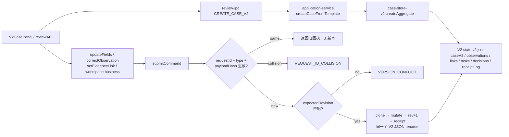
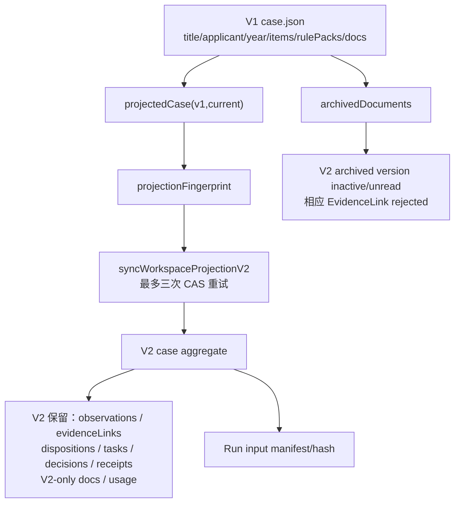
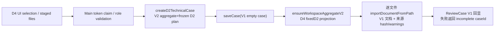

# 01｜案卷、事实状态与真实写入链审查

**范围**：Review V3 Round 2A；只读静态审查。状态 **PARTIAL（固定源码核查完成，跨进程与 GUI 测试未执行）**。以 [PR #133](https://github.com/Fuck-GH-Admin/cdut-studio-review-agent/pull/133) / [PR #134](https://github.com/Fuck-GH-Admin/cdut-studio-review-agent/pull/134) 为历史索引，不能用 PR 标题代替代码证据。

## 0. 固定来源与隔离

| 源 | SHA | 用途 |
|---|---|---|
| main | `8989941b6fb5651564e32d11c4215b6a6d5a5209` | V1/V2 共同原始接口与存储 |
| D4 W1 / #129 | `c2f965d29022a42b3c32d6a4cb73aa8fd542329b` | D2 计划与 D4 建案、材料处理 |
| P06 R03 / #132 | `db0284879f75ce123b5d83cb6577a3cc7ad057da` | 业务决策、后台批次、Renderer 身份 |
| 1.5 遗产 / #134 | `54b906dc7f4dcd06d8ca14ae39798bf18336e7d6` | CASE/UI/EXT 能力编号与遗产假设 |

GitHub compare 已独立查询：main→D4 为 **diverged ahead 333 / behind 170**；main→P06 为 **ahead 113**；D4→P06 为 **diverged ahead 283 / behind 333**，大范围 compare 文件清单有 300 项截断。因此下面的 D4 路径与 P06 路径**是两个不同 SHA 的独立行为样本，不是一个集成发行版**。本次未创建本机 worktree：执行环境不能解析 github.com，采用从固定 main 创建的远端独立审计分支；未运行测试。状态 **VERIFIED（远端 SHA/compare）** / **BLOCKED（本机运行）**。

## 1. V1 工作台创建、文件、人工更正、运行（VERIFIED：源码）

```mermaid
flowchart LR
 U["V1 三栏工作台<br/>ContentReviewView / Actions"] --> PL["preload reviewAPI"]
 PL --> IPC["Main review-ipc"]
 IPC --> CR["CREATE_CASE / createEmptyCase"]
 CR --> V1["V1 case.json<br/>case-store.saveCase"]
 IPC --> UP["UPDATE_CASE_SETTINGS<br/>UPDATE_REVIEW_ITEM<br/>UPDATE_RULE_OUTLINE"]
 UP --> Q1["case-store.updateCase<br/>V1 revision queue"]
 IPC --> IMP["case-import:<br/>import/remove/reorder/confirm"]
 IMP --> Q1
 Q1 --> V1
 IPC --> SYNC["ensure/syncWorkspaceProjectionV2"]
 CR --> SYNC
 UP --> SYNC
 V1 --> SYNC
 SYNC --> CM["V2 submitCommand<br/>SyncReviewWorkspaceProjection"]
 CM --> V2["V2 aggregate + receipt"]
 IPC --> RUN["legacy RUN + V2 RUN endpoints"]
 RUN --> RH["V1 runs or V2 run-store<br/>NOT interchangeable"]
```

- `CREATE_CASE` 先通过 `createEmptyCase` 创建 V1，再 `ensureWorkspaceAggregateV2`；`UPDATE_CASE_SETTINGS`、`UPDATE_RULE_OUTLINE`、`UPDATE_REVIEW_ITEM` 是 **V1 先写、V2 后投影**。证据：[apps/electron/src/main/lib/review/review-ipc.ts:115](https://github.com/Fuck-GH-Admin/cdut-studio-review-agent/blob/db0284879f75ce123b5d83cb6577a3cc7ad057da/apps/electron/src/main/lib/review/review-ipc.ts#L115), [apps/electron/src/main/lib/review/review-ipc.ts:225](https://github.com/Fuck-GH-Admin/cdut-studio-review-agent/blob/db0284879f75ce123b5d83cb6577a3cc7ad057da/apps/electron/src/main/lib/review/review-ipc.ts#L225), [apps/electron/src/main/lib/review/review-ipc.ts:249](https://github.com/Fuck-GH-Admin/cdut-studio-review-agent/blob/db0284879f75ce123b5d83cb6577a3cc7ad057da/apps/electron/src/main/lib/review/review-ipc.ts#L249), [apps/electron/src/main/lib/review/review-ipc.ts:270](https://github.com/Fuck-GH-Admin/cdut-studio-review-agent/blob/db0284879f75ce123b5d83cb6577a3cc7ad057da/apps/electron/src/main/lib/review/review-ipc.ts#L270)。
- 文档经 `case-import.importDocumentFromPath/removeDocumentsFromCase/reorderDocumentsInCase/confirmRulePackInCase` 改 V1；人工更正事项由 `updateCase` 定向写；V1 提取/大纲请求会触发后续同步（调用路径要结合各服务触发点检查，不能把所有入口视为无条件同步）。证据：[apps/electron/src/main/lib/review/case-import.ts:177](https://github.com/Fuck-GH-Admin/cdut-studio-review-agent/blob/db0284879f75ce123b5d83cb6577a3cc7ad057da/apps/electron/src/main/lib/review/case-import.ts#L177), [apps/electron/src/main/lib/review/case-import.ts:276](https://github.com/Fuck-GH-Admin/cdut-studio-review-agent/blob/db0284879f75ce123b5d83cb6577a3cc7ad057da/apps/electron/src/main/lib/review/case-import.ts#L276), [apps/electron/src/main/lib/review/case-import.ts:328](https://github.com/Fuck-GH-Admin/cdut-studio-review-agent/blob/db0284879f75ce123b5d83cb6577a3cc7ad057da/apps/electron/src/main/lib/review/case-import.ts#L328), [apps/electron/src/main/lib/review/review-ipc.ts:888](https://github.com/Fuck-GH-Admin/cdut-studio-review-agent/blob/db0284879f75ce123b5d83cb6577a3cc7ad057da/apps/electron/src/main/lib/review/review-ipc.ts#L888)。
- `case-store.ts` `saveCase` (181) 原子 rename；`updateCase` (234) 同案进程内队列、可选 expectedRevision、revision+1；`saveRun/listRuns` (324/336) 是**独立旧运行格式**。未证明跨进程锁或断电 fsync。证据：[apps/electron/src/main/lib/review/case-store.ts:71](https://github.com/Fuck-GH-Admin/cdut-studio-review-agent/blob/8989941b6fb5651564e32d11c4215b6a6d5a5209/apps/electron/src/main/lib/review/case-store.ts#L71), [apps/electron/src/main/lib/review/case-store.ts:181](https://github.com/Fuck-GH-Admin/cdut-studio-review-agent/blob/8989941b6fb5651564e32d11c4215b6a6d5a5209/apps/electron/src/main/lib/review/case-store.ts#L181), [apps/electron/src/main/lib/review/case-store.ts:234](https://github.com/Fuck-GH-Admin/cdut-studio-review-agent/blob/8989941b6fb5651564e32d11c4215b6a6d5a5209/apps/electron/src/main/lib/review/case-store.ts#L234), [apps/electron/src/main/lib/review/case-store.ts:324](https://github.com/Fuck-GH-Admin/cdut-studio-review-agent/blob/8989941b6fb5651564e32d11c4215b6a6d5a5209/apps/electron/src/main/lib/review/case-store.ts#L324)。
- `input-invalidation.invalidateDerivedReviewInputs` 清 V1 派生事项、规则大纲，不自行修改已存 V2 run；是否过期由运行输入 hash/checker 判定。证据：[apps/electron/src/main/lib/review/input-invalidation.ts:13](https://github.com/Fuck-GH-Admin/cdut-studio-review-agent/blob/8989941b6fb5651564e32d11c4215b6a6d5a5209/apps/electron/src/main/lib/review/input-invalidation.ts#L13)。

## 2. V2 原生案卷与事务（VERIFIED：代码边界；PARTIAL：可靠性）

- `createCaseFromTemplate` 建原生 V2 聚合、初始 Receipt，不需要 V1 `saveCase`；所以**不能说所有新案卷都必须经过 V1**。证据：[apps/electron/src/main/lib/review/review-ipc.ts:515](https://github.com/Fuck-GH-Admin/cdut-studio-review-agent/blob/db0284879f75ce123b5d83cb6577a3cc7ad057da/apps/electron/src/main/lib/review/review-ipc.ts#L515), [apps/electron/src/main/lib/review/application-service.ts:91](https://github.com/Fuck-GH-Admin/cdut-studio-review-agent/blob/db0284879f75ce123b5d83cb6577a3cc7ad057da/apps/electron/src/main/lib/review/application-service.ts#L91), [apps/electron/src/main/lib/review/application-service.ts:152](https://github.com/Fuck-GH-Admin/cdut-studio-review-agent/blob/db0284879f75ce123b5d83cb6577a3cc7ad057da/apps/electron/src/main/lib/review/application-service.ts#L152)。
- `submitCommand` 在同案进程内串行、以 `type|JSON.stringify(payload)` 计算 payloadHash；先查 `requestId`（相同返回旧回执、不同拒绝），再 CAS，成功一次附加 Receipt 并落同一聚合文件。**它不与 V1 `case.json`、独立 Run 文件、outbox 构成跨文件原子事务**。[apps/electron/src/main/lib/review/case-store-v2.ts:79](https://github.com/Fuck-GH-Admin/cdut-studio-review-agent/blob/8989941b6fb5651564e32d11c4215b6a6d5a5209/apps/electron/src/main/lib/review/case-store-v2.ts#L79), [apps/electron/src/main/lib/review/case-store-v2.ts:99](https://github.com/Fuck-GH-Admin/cdut-studio-review-agent/blob/8989941b6fb5651564e32d11c4215b6a6d5a5209/apps/electron/src/main/lib/review/case-store-v2.ts#L99), [apps/electron/src/main/lib/review/case-store-v2.ts:115](https://github.com/Fuck-GH-Admin/cdut-studio-review-agent/blob/8989941b6fb5651564e32d11c4215b6a6d5a5209/apps/electron/src/main/lib/review/case-store-v2.ts#L115)。
- 事务级 actor 与来源写回 Receipt；调用端的 actor 是否可信取决于 Main 的每个 IPC 校验，而非 `submitCommand` 本身。[apps/electron/src/main/lib/review/review-ipc-actor-guard.ts:10](https://github.com/Fuck-GH-Admin/cdut-studio-review-agent/blob/db0284879f75ce123b5d83cb6577a3cc7ad057da/apps/electron/src/main/lib/review/review-ipc-actor-guard.ts#L10)。目前 `CORRECT_OBSERVATION_V2`、`SET_EVIDENCE_LINK_V2`、`UPDATE_FIELDS_V2`、`CREATE_CASE_V2` 的 IPC 接口**没有调用**用于业务决定入口的 `bindLocalReviewerCommand`，需独立验证服务层权限及历史 Receipt 伪造风险，不能仅由 TypeScript Actor 类型证明认证。[apps/electron/src/main/lib/review/review-ipc.ts:515](https://github.com/Fuck-GH-Admin/cdut-studio-review-agent/blob/db0284879f75ce123b5d83cb6577a3cc7ad057da/apps/electron/src/main/lib/review/review-ipc.ts#L515), [apps/electron/src/main/lib/review/review-ipc.ts:526](https://github.com/Fuck-GH-Admin/cdut-studio-review-agent/blob/db0284879f75ce123b5d83cb6577a3cc7ad057da/apps/electron/src/main/lib/review/review-ipc.ts#L526), [apps/electron/src/main/lib/review/review-ipc.ts:586](https://github.com/Fuck-GH-Admin/cdut-studio-review-agent/blob/db0284879f75ce123b5d83cb6577a3cc7ad057da/apps/electron/src/main/lib/review/review-ipc.ts#L586), [apps/electron/src/main/lib/review/review-ipc.ts:591](https://github.com/Fuck-GH-Admin/cdut-studio-review-agent/blob/db0284879f75ce123b5d83cb6577a3cc7ad057da/apps/electron/src/main/lib/review/review-ipc.ts#L591)。状态 **PARTIAL（身份链存在静态缺口，尚无动态利用结论）**。

## 3. V1 → V2 投影与所有权（VERIFIED：源码）

在 **P06 SHA**：`projectedCase` 将 V1 当前 `items` 转成 subjects（沿用上次 V2-only 字段）、当前 `rulePacks/manualRules` 投影成 rules；`documents` 以 `-v1` 身份标注、原归档材料变 inactive；保留无 V1 行的 V2-only 版本与以前人工作用的 `usage`、版本链。执行 `SyncReviewWorkspaceProjection` 时 `caseV2` 字段与链接在 V2 事务中写，**不覆盖数组级人工观察、决定和任务**。证据：[apps/electron/src/main/lib/review/workspace-service-v2.ts:22](https://github.com/Fuck-GH-Admin/cdut-studio-review-agent/blob/db0284879f75ce123b5d83cb6577a3cc7ad057da/apps/electron/src/main/lib/review/workspace-service-v2.ts#L22), [apps/electron/src/main/lib/review/workspace-service-v2.ts:63](https://github.com/Fuck-GH-Admin/cdut-studio-review-agent/blob/db0284879f75ce123b5d83cb6577a3cc7ad057da/apps/electron/src/main/lib/review/workspace-service-v2.ts#L63), [apps/electron/src/main/lib/review/workspace-service-v2.ts:95](https://github.com/Fuck-GH-Admin/cdut-studio-review-agent/blob/db0284879f75ce123b5d83cb6577a3cc7ad057da/apps/electron/src/main/lib/review/workspace-service-v2.ts#L95), [apps/electron/src/main/lib/review/workspace-service-v2.ts:163](https://github.com/Fuck-GH-Admin/cdut-studio-review-agent/blob/db0284879f75ce123b5d83cb6577a3cc7ad057da/apps/electron/src/main/lib/review/workspace-service-v2.ts#L163)。

**不同 SHA 的关键分叉**：D4 W1 的 `projectedCase(v1,current,fixedD2)` 在 `current.d2RuntimePlan` 存在时保留 V2 `subjects/reviewRules` 并锁定当前模板，且不把 V1 items 再绑定候选证据；P06 R03 版没有 `fixedD2` 条件。**不能将 P06 的投影逻辑误当成 D4 的实际建案行为，也不能未经合并就去掉 D4 冻结保护**。证据：[apps/electron/src/main/lib/review/workspace-service-v2.ts:22](https://github.com/Fuck-GH-Admin/cdut-studio-review-agent/blob/c2f965d29022a42b3c32d6a4cb73aa8fd542329b/apps/electron/src/main/lib/review/workspace-service-v2.ts#L22), [apps/electron/src/main/lib/review/workspace-service-v2.ts:113](https://github.com/Fuck-GH-Admin/cdut-studio-review-agent/blob/c2f965d29022a42b3c32d6a4cb73aa8fd542329b/apps/electron/src/main/lib/review/workspace-service-v2.ts#L113), [apps/electron/src/main/lib/review/workspace-service-v2.ts:175](https://github.com/Fuck-GH-Admin/cdut-studio-review-agent/blob/c2f965d29022a42b3c32d6a4cb73aa8fd542329b/apps/electron/src/main/lib/review/workspace-service-v2.ts#L175), [apps/electron/src/main/lib/review/workspace-service-v2.ts:204](https://github.com/Fuck-GH-Admin/cdut-studio-review-agent/blob/c2f965d29022a42b3c32d6a4cb73aa8fd542329b/apps/electron/src/main/lib/review/workspace-service-v2.ts#L204)。

`migration.migrateCaseToV2` 另有 legacy `case.v2.json` 迁移路径，历史 V1 runs **明确不迁移**。该 JSON 与聚合数据必须盘点，不能认为存在迁移函数就证明 Run/Receipt 无损。[apps/electron/src/main/lib/review/migration.ts:104](https://github.com/Fuck-GH-Admin/cdut-studio-review-agent/blob/db0284879f75ce123b5d83cb6577a3cc7ad057da/apps/electron/src/main/lib/review/migration.ts#L104)。

## 4. D4 W1 原生建案实链（VERIFIED：源码，PARTIAL：跨文件失败恢复）

[apps/electron/src/main/lib/review/review-d4-client.ts:41](https://github.com/Fuck-GH-Admin/cdut-studio-review-agent/blob/c2f965d29022a42b3c32d6a4cb73aa8fd542329b/apps/electron/src/main/lib/review/review-d4-client.ts#L41)→[apps/electron/src/main/lib/review/review-d2-runtime.ts:402](https://github.com/Fuck-GH-Admin/cdut-studio-review-agent/blob/c2f965d29022a42b3c32d6a4cb73aa8fd542329b/apps/electron/src/main/lib/review/review-d2-runtime.ts#L402)→[apps/electron/src/main/lib/review/review-d4-client.ts:82](https://github.com/Fuck-GH-Admin/cdut-studio-review-agent/blob/c2f965d29022a42b3c32d6a4cb73aa8fd542329b/apps/electron/src/main/lib/review/review-d4-client.ts#L82)→[apps/electron/src/main/lib/review/review-d4-client.ts:91](https://github.com/Fuck-GH-Admin/cdut-studio-review-agent/blob/c2f965d29022a42b3c32d6a4cb73aa8fd542329b/apps/electron/src/main/lib/review/review-d4-client.ts#L91)→[apps/electron/src/main/lib/review/review-d4-client.ts:99](https://github.com/Fuck-GH-Admin/cdut-studio-review-agent/blob/c2f965d29022a42b3c32d6a4cb73aa8fd542329b/apps/electron/src/main/lib/review/review-d4-client.ts#L99)。D4 的 **V2-first + V1 façade + 同步** 与传统 V1-first 不同。建案后导入失败会登记 warning 或抛 `D4_CASE_CREATED_INCOMPLETE`、保留 caseId，不是单一数据库事务回滚。相关 `review-d4-case-batch.ts` 是**文件变动/重新导入事务**，不是 P06 `batch-store.ts` 审核执行队列。[apps/electron/src/main/lib/review/review-d4-client.ts:115](https://github.com/Fuck-GH-Admin/cdut-studio-review-agent/blob/c2f965d29022a42b3c32d6a4cb73aa8fd542329b/apps/electron/src/main/lib/review/review-d4-client.ts#L115), [apps/electron/src/main/lib/review/review-d4-case-batch.ts:46](https://github.com/Fuck-GH-Admin/cdut-studio-review-agent/blob/c2f965d29022a42b3c32d6a4cb73aa8fd542329b/apps/electron/src/main/lib/review/review-d4-case-batch.ts#L46)。

## 5. 唯一权威状态分区与直接入口（候选裁定）

| 事实类别 | 当前实际写权（按路径） | 证据状态 | 第三轮处理要求 |
|---|---|---|---|
| 传统表单 applicant/year/items/manualRules/V1-origin docs | V1 case.json，随后投影 V2 | VERIFIED | 一个规范写 API；迁移期显式字段级归属和 sync journal |
| 原生 V2/D2 subjects/frozen rules/模板版本 | V2 aggregate；D4 fixedD2 隔离 | VERIFIED @D | 冻结 Plan 不准被 V1 投影覆盖 |
| Observation/人工纠错、EvidenceLink、材料已读 | V2 aggregate + Receipt | VERIFIED | 确认优先级、归档失效、source scope 安全 |
| Workflows、补件、评分/申诉、BusinessDecision | V2 aggregate + Receipt（存在多个业务 service） | PARTIAL | 一个有效决定投影与明确历史附注；再测生命周期 |
| V1 runs / V2 run-store / D2 Plan check | 独立运行记录/manifest | PARTIAL | 禁止 synthetic `run@rev` 作为 finality 真来源 |
| 旧 V1 case.v2.json、独立副本 outbox、学校外部回执 | 不同兼容/交接文件、Mock 接口 | PARTIAL | 保留历史但不能混作当前权威；断点/重放设计 |

**V1 直接写目录（非封闭总表，已检出的显式入口）**：`review-ipc.CREATE_CASE/UPDATE_CASE_SETTINGS/UPDATE_RULE_OUTLINE/UPDATE_REVIEW_ITEM`；`case-import.importDocumentFromPath/removeDocumentsFromCase/reorderDocumentsInCase/confirmRulePackInCase`；`review-d4-client.createD4ClientCase`；`review-d4-case-batch.applyD4CaseBatch`；`review-d4-field-form.saveD4ReviewerForm`；`workspace-service-v2.upgradeLegacyComprehensiveTemplateAssignment`；`loadDemoCase`。逐文件源见上方锚点。全仓动态调用、第三方插件调用和运行态覆盖仍 **PARTIAL**。

## 6. 结论与禁止事项

- **VERIFIED**：有两个可写持久层、两个不同 revision 与写队列，投影为实际 V1/V2 协调机制；也存在 V2-native no-V1 创建路线。
- **PARTIAL**：无法证明“任意时刻两份完整业务事实都同时为权威”；更准确的说法是**字段级 V1/V2 分割所有权 + 同一申报数据有两份可写表示 + 非事务投影窗口**。
- **PARTIAL**：UI 与 Main 有不同 Actor 约束；须全入口负例实测，不仅复用现有成功路径。
- **BLOCKED**：独立 worktree、本地单测、GUI、真实 Provider、学校凭据、断电测试未执行；不得据此合并重构。
