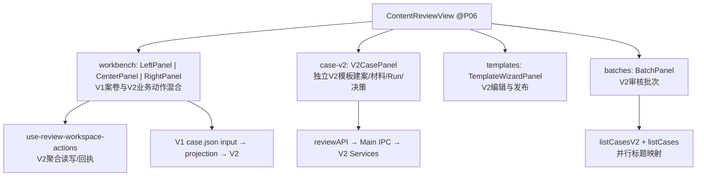

# 03｜V1/V2 工作台能力与真实接线

审查状态：**PARTIAL**（组件、Controller/Hook、Main 路由静态追踪，**非**真实 GUI 验收）。固定 SHA：main `8989941b6fb5651564e32d11c4215b6a6d5a5209`、D4 W1 `c2f965d29022a42b3c32d6a4cb73aa8fd542329b`、P06 R03 `db0284879f75ce123b5d83cb6577a3cc7ad057da`，遗产 ID 依 #134。列出的产品候选不是第三轮架构裁定。

## 1. 当前页面不是只有一套案卷入口

证明：[apps/electron/src/renderer/components/content-review/ContentReviewView.tsx:210](https://github.com/Fuck-GH-Admin/cdut-studio-review-agent/blob/db0284879f75ce123b5d83cb6577a3cc7ad057da/apps/electron/src/renderer/components/content-review/ContentReviewView.tsx#L210), [apps/electron/src/renderer/components/content-review/ContentReviewView.tsx:243](https://github.com/Fuck-GH-Admin/cdut-studio-review-agent/blob/db0284879f75ce123b5d83cb6577a3cc7ad057da/apps/electron/src/renderer/components/content-review/ContentReviewView.tsx#L243), [apps/electron/src/renderer/components/content-review/BatchPanel.tsx:106](https://github.com/Fuck-GH-Admin/cdut-studio-review-agent/blob/db0284879f75ce123b5d83cb6577a3cc7ad057da/apps/electron/src/renderer/components/content-review/BatchPanel.tsx#L106), [apps/electron/src/renderer/components/content-review/V2CasePanel.tsx:145](https://github.com/Fuck-GH-Admin/cdut-studio-review-agent/blob/db0284879f75ce123b5d83cb6577a3cc7ad057da/apps/electron/src/renderer/components/content-review/V2CasePanel.tsx#L145)。

两个列表（`listCases()` 与 `listCasesV2()`）同时供批次 UI 使用，意味着独立原生 V2 案卷可能没有 V1 表单记录；选择同案时页面来源不同，**列表 fallback 与内容/状态一致性没有本轮 GUI 证明**。旧三栏与 V2CasePanel 共享部分业务服务，但不是同一个界面状态源。建议统一导航/上下文而**保留已实现的双类高级动作**。

## 2. ID 逐项核验

| ID | 真实入口/实现与正面价值 | 限制/冲突 | 状态 / 候选 |
|---|---|---|---|
| UI-01 | `ContentReviewView` 三栏 Left/Center/Right，窄屏切单栏，保留文档—规则—问题空间联系；[apps/electron/src/renderer/components/content-review/ContentReviewView.tsx:210](https://github.com/Fuck-GH-Admin/cdut-studio-review-agent/blob/db0284879f75ce123b5d83cb6577a3cc7ad057da/apps/electron/src/renderer/components/content-review/ContentReviewView.tsx#L210) | V1 输入与 V2 action/hook 并用，D4 接入又有不同代码分叉；真实多格式 GUI 未验 | **PARTIAL / REFACTOR** |
| UI-02 | `SourceBlockView` 渲染块+图片，调用 Main preview path，并登记受控 preview；[apps/electron/src/renderer/components/content-review/SourceBlockView.tsx:57](https://github.com/Fuck-GH-Admin/cdut-studio-review-agent/blob/db0284879f75ce123b5d83cb6577a3cc7ad057da/apps/electron/src/renderer/components/content-review/SourceBlockView.tsx#L57) | UI 高亮不等于 Main 来源验证；Office/扫描/同名多源的 parseRevision 和文件内容锚点未复验 | **PARTIAL / REFACTOR** |
| UI-03 | `RunResultPanel` 用 `listRunsV2/getAggregateV2/getTemplateV2` 呈现运行，`runReviewV2/exportReportV2` 真 Main 接口；[apps/electron/src/renderer/components/content-review/RunResultPanel.tsx:22](https://github.com/Fuck-GH-Admin/cdut-studio-review-agent/blob/db0284879f75ce123b5d83cb6577a3cc7ad057da/apps/electron/src/renderer/components/content-review/RunResultPanel.tsx#L22) | completed、partially-completed、技术失败与合规性不同；空 findings 不得等于通过 | **PARTIAL / REFACTOR** |
| UI-04 | `CaseTimelinePanel` 调 `getCaseTimelineV2` 并按 actor 来源过滤，V2 `receiptLog` 有 actor；[apps/electron/src/renderer/components/content-review/CaseTimelinePanel.tsx:41](https://github.com/Fuck-GH-Admin/cdut-studio-review-agent/blob/db0284879f75ce123b5d83cb6577a3cc7ad057da/apps/electron/src/renderer/components/content-review/CaseTimelinePanel.tsx#L41), [apps/electron/src/main/lib/review/review-ipc.ts:558](https://github.com/Fuck-GH-Admin/cdut-studio-review-agent/blob/db0284879f75ce123b5d83cb6577a3cc7ad057da/apps/electron/src/main/lib/review/review-ipc.ts#L558) | 部分基础字段类 V2 IPC actor 未可信重绑定；旧历史记录 actor 缺省不可补造 | **PARTIAL / REFACTOR** |
| UI-05 | `BatchPanel` 可建批、运行、查看 Run 匹配、自动化处理、完成定稿、重试与异常；[apps/electron/src/renderer/components/content-review/BatchPanel.tsx:208](https://github.com/Fuck-GH-Admin/cdut-studio-review-agent/blob/db0284879f75ce123b5d83cb6577a3cc7ad057da/apps/electron/src/renderer/components/content-review/BatchPanel.tsx#L208) | `done` 不等于已通过，执行批次和 D4 材料导入批次不等价，Run 绑定需要逐批追溯 | **PARTIAL / REFACTOR** |
| UI-06 | `TemplateWizardPanel` 调 V2 模板保存、发布、重排、移除、恢复；[apps/electron/src/renderer/components/content-review/TemplateWizardPanel.tsx:178](https://github.com/Fuck-GH-Admin/cdut-studio-review-agent/blob/db0284879f75ce123b5d83cb6577a3cc7ad057da/apps/electron/src/renderer/components/content-review/TemplateWizardPanel.tsx#L178), [apps/electron/src/renderer/components/content-review/TemplateWizardPanel.tsx:235](https://github.com/Fuck-GH-Admin/cdut-studio-review-agent/blob/db0284879f75ce123b5d83cb6577a3cc7ad057da/apps/electron/src/renderer/components/content-review/TemplateWizardPanel.tsx#L235) | 源码存在编辑操作不等于从空白创建并校内确认/发布全业务闭环；D0.5 demo 不作另一生产内核 | **PARTIAL / REFACTOR** |

## 3. 用户实际业务动作与持久化回执

| 动作 | 控件 / Hook | Main 路径 | 实际观察 |
|---|---|---|---|
| V2-native 建案/提交 | `V2CasePanel.createFromTemplate/submitCase` | `CREATE_CASE_V2→createCaseFromTemplate`; `SUBMIT_CASE_V2→submitCaseV2` | V2 真实聚合；**不要求 V1 数据行** |
| V1 设置/规则/申报项改动 | V1 工作台 actions 与 IPC | V1 `updateCase` 后 `syncWorkspaceProjectionV2` | 两次持久化与分离修订，错误/同步冲突可能令 UI 回显与 V2 状态不一致 |
| 人工更正事实 | `useReviewWorkspaceActions.confirmObservation` | `CORRECT_OBSERVATION_V2→application-service.correctObservation→submitCommand` | V2 Receipt；**Actor IPC 未做 local rebind** |
| 证据确认/拒绝 | `transitionEvidenceLink` | `SET_EVIDENCE_LINK_V2→setEvidenceLink` | V2 Receipt；**同类身份缺口** |
| 已读、问题处置、补件、事项认定、决定 | `use-review-workspace-actions.ts` | V2 `RECORD_WORKSPACE_*` 等，经 `bindLocalReviewerCommand` | 命令返回 `ok/receipt/aggregate`，存在 Main 授权/readiness 栅栏 |
| 模板编辑发布 | `TemplateWizardPanel` | `SAVE_TEMPLATE_DRAFT_V2` / `PUBLISH_TEMPLATE_V2` | 模板存储能力；校规/ACL 未接入 |
| 评分/申诉/独立评委 | V2 服务/离线往返代码 | `judging-service/rating-service/stage-workflow/offline-roundtrip` | **并未静态证实完全可从 GUI 连续操作** |

关键 Controller：[apps/electron/src/renderer/components/content-review/use-review-workspace-actions.ts:42](https://github.com/Fuck-GH-Admin/cdut-studio-review-agent/blob/db0284879f75ce123b5d83cb6577a3cc7ad057da/apps/electron/src/renderer/components/content-review/use-review-workspace-actions.ts#L42) 定义了确认事实、证据变更、材料已读、问题处置、补件回复、最终决定和事项认定。其 `apply` 采用 `beginWorkspaceCaseWrite` 先分代际，异步后落 Atom 以抑制旧案迟到 UI 刷新：[apps/electron/src/renderer/components/content-review/use-review-workspace-actions.ts:87](https://github.com/Fuck-GH-Admin/cdut-studio-review-agent/blob/db0284879f75ce123b5d83cb6577a3cc7ad057da/apps/electron/src/renderer/components/content-review/use-review-workspace-actions.ts#L87)。这**只是前端展示顺序栅栏，不代替 V2 CAS 或权限认证**。`V2CasePanel.applyResult` 展示 Receipt/失败码：[apps/electron/src/renderer/components/content-review/V2CasePanel.tsx:109](https://github.com/Fuck-GH-Admin/cdut-studio-review-agent/blob/db0284879f75ce123b5d83cb6577a3cc7ad057da/apps/electron/src/renderer/components/content-review/V2CasePanel.tsx#L109)，值得保留。

## 4. D4 与 P06 的 UI 兼容差

- 仅 @D4 W1 tree 中存在 `D4CaseSetup.tsx`、`D4GenericObjectForm.tsx`、`D4ReviewerFormEditor.tsx`、`D4IntakePicker.tsx`、`D4CaseBatchControls.tsx`；而 P06 R03 主要新 UI 是 `BatchAutomationDialog.tsx`、`BatchGroupActionDialog.tsx`、`SupplementRequeueDialog.tsx`。固定 tree 已核对；两个 SHA 在 `review-ipc.ts` 和工作台存在真实分叉。
- D4 `review-d4-client.ts` 的选择/材料指派/创建以及 D2 Plan 保护与 P06 的 V2 批次/用户回执都不可因重构而遗漏。
- V1 优点是三栏原件上下文、快捷审核与人工校正；V2 优点是单案事务、严格结果提示、阶段/补件及批次操作；二者各自也包含需要限制的模拟/兼容入口。**禁止 V1=仅 UI、V2=完美核心**的先验结论。

## 5. 需跑的 UI 验收（本轮 BLOCKED）

1. 同一 V1/V2 案卷打开两页、返回、改字段、刷新，比较 `case.json` 与聚合字段及 Receipt。
2. 单独原生 V2 案卷不含 V1 case.json 时，从批次与时间线定位；检验无空白页/错误 fallback。
3. 文档切换、Office 同名不同源、图片/扫描页、归档页定位及高亮。
4. 人工确认后 Pi 再抽取不得以“最新时间”错误替代人工真值。
5. 裁决/补件/申诉/评分三类完整用户流程分别记录屏幕操作、Main 回执、持久化重开结果。
6. D4 固定 D2 Plan 在改旧表单后的规则/subjects 不漂移；P06 UI 同时有批次与工作台，并非两个功能隔离应用。

**最终状态**：源码能力存在≠可用 GUI；组件引用≠后端回执已持久化；本轮未执行 Electron，也未得到学校级身份和真实 Provider。后续 2D 应保留 UI 资产和负例，不应以静态页面审查代替交互验收。
