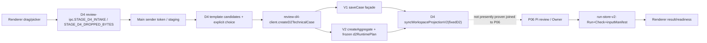
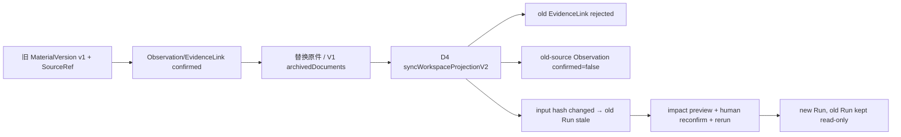
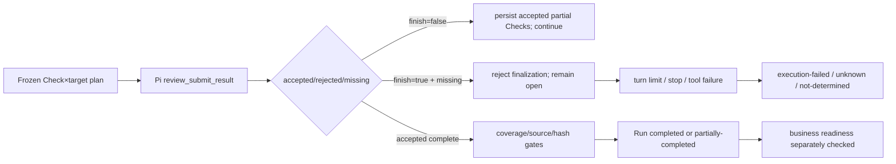
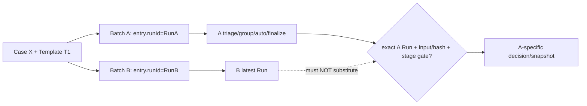
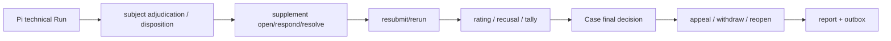
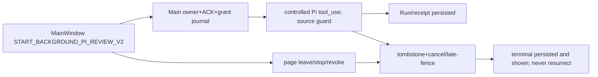
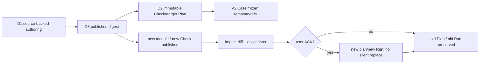

# 02｜七条跨系统端到端业务链：实际入口、状态变化与反例门禁

**状态：PARTIAL（固定 SHA 静态调用链核验；本轮所有测试 NOT_RUN）。** 这些链路目前分属不同分支，并非一个可运行的合并版本。每条图中的虚线含义为**拟议的衔接点，未证明已接通**。源码快照：main `8989941b6fb5651564e32d11c4215b6a6d5a5209`、D4 `c2f965d29022a42b3c32d6a4cb73aa8fd542329b`、P06 `db0284879f75ce123b5d83cb6577a3cc7ad057da`。上游专项证据分别见 #135 01/05、#136 04/06 和 #137 01/03/04/05。本次独立读了 D4/P06 的 `review-ipc.ts`、`pi-case-review-service.ts`、`workspace-service-v2.ts`，以及 P06 的 `batch-store.ts`、`workspace-business-service-v2.ts`。

## A｜新用户首次审核（PARTIAL；未验证整链）

**真实状态流**：staging token（非可信任意路径）→ 材料角色和文件候选 → D2 target/check mapping + fingerprint → V2 CaseAggregate + 单独 V1 case.json → V2 projection receipt → Run/Check。另一条 V1 工作台 `CREATE_CASE` 先写 V1 后投影，V2-native `CREATE_CASE_V2` 只建 aggregate；三者不可笼统称为同一“建案”事务。冻结计划不允许无确认的模板切换；D4 `UPDATE_CASE_SETTINGS` 额外拒绝固定 D2 案卷的模板/领域变动（`review-ipc.ts:249`），P06 的同名 IPC 不包含该门禁。
**反例门禁 A1–A5**：拖入多文件与同名 ZIP；改 role/application/evidence；变更推荐模板后用户明确 ACK；两个 target 对同一 source 的出处隔离；中断 V2 建卷与 V1 façade 之间的写入并重启恢复。不得隐式设置全案“已批准”。**现有证据**：2B TB-01..TB-15、D4 单元测试**定义**；此次没有 Electron GUI/真实 Office 实测。

## B｜材料修订、事实更正与再次审核（PARTIAL；归档差分源码 VERIFIED）

**固定差异**：D4 `workspace-service-v2.ts:166–210` 在 archive 时既拒绝链接，又撤销来源已归档的 Observation 当前 confirmed；P06 `workspace-service-v2.ts:163–207` 仅拒链接、不包含 Observation 撤销。因此**不能**把 P06 投影整体覆写 D4，尤其不得在聚合后仍把旧 confirmed 值当新证据。另需验证 `latestObservations` 的人工作用优先级、`EvidenceLink` `documentVersionId` 验证、Check/Run stale 显示、决策/出站是否需撤回：现有源码核查不能证明全链传播。
**门禁 B1–B5**：旧出处被归档时人工 confirmed 撤效；新版本具有不同 blockId；恢复旧版本不得重写 Receipt；旧 Run/正式决定只读留痕且不能再作为新批次有效依据；输入 hash 改变后未重新阅读不得再通过。**状态**：静态局部 VERIFIED；完整链路 PARTIAL；测试 NOT_RUN。

## C｜单案审核部分提交或技术失败（PARTIAL）

**不能等价的状态**：Check 缺失、无出处、数值算错、工具执行失败、Run `completed`、Case 正式 `pass` 是不同事实层。D4 `pi-case-review-service.ts:855` 与 P06 `:840` 分别管理分段提交，验证 `missingChecks`/rejected，Run 的最终落盘来自 `run-store-v2`。P06 `decideWorkspaceCaseV2:277–294` 禁止 D2 技术预审作正式行政通过，要求真实 Run、输入 hash、已发布模板及 readiness。
**门禁 C1–C6**：九项中漏第九项；200 差额计算（1680−1480）；跨案引用；quote 错误；24 轮耗尽且先前已有 accepted；rejected 后补交同 Check；各自断言“不知道 ≠ 合格，执行失败 ≠ 业务不合格”。Provider 真 `tool_use` 未授权/未实测。

## D｜同案跨两个批次（PARTIAL；高风险负例未复现）

P06 `review-ipc.ts:634–659` `RUN_BATCH_V2` 通过 `runBatchQueue` 将真实 Run ID 写入队列；`batch-store.ts:589–594` 的注入接口同时允许 `completed` 而 `runId=undefined`，不能把 `done` 认作真实来源。R02 以 `runId + runInputHash` 双绑定，R03 持久仅 `runId` 并重算当前输入，有一定拒止但**不同证据模型**。P06 `batch-store.ts:236–262` 的 `assertBatchBusinessReadyForFinalization` 已由2D独立全文读取：要求所有entry状态done、聚合stage为decided/archived、模板一致、无未办任务/申诉/补件、存在有效最终决定；**没有检查entry.runId非空，也没有比较decision.basedOnRunId===entry.runId**。静态省略 VERIFIED，跨批造成错误定稿的可达性仍待反例实证。
**门禁 D1–D7**：A/B 不同 Run；B newer 且全部通过而 A 缺项；旧 done 无 runId；补件只回流指定 Batch；A 自动/按组/finalize 不可消费 B；旧 snapshot/Receipt 不可修改；未知来源 fail closed。状态：调用片段静态 VERIFIED，端到端独立测试 NOT_RUN。

## E｜复杂人工生命周期（PARTIAL / 学校身份 BLOCKED）

V2 的 `stage-workflow.ts`、`workspace-business-service-v2.ts`、`application-service.ts` 分散维护流程字段，V1 工作台/历史流程并非自动覆盖。P06 `review-ipc.ts:721–723` 将 `RESOLVE_APPEAL_V2` 绑定 local reviewer，而 `stage-workflow.resolveAppealV2` 要求 teacher，属于实际接口矛盾；具体授权仍需真实校方身份链。旧 `run@rev` 只是历史兼容标记，不可伪装真 Run。
**门禁 E1–E7**：角色 reviewer/teacher/student/agent/system；申诉 actor 最小权限；回避评委禁止评分；补件后旧决定/分项评分效力；reopen 保留历史；离线出站同 requestId；报告展示正确旧版本且不伪装 LIVE。真实学校 API 全部 BLOCKED。

## F｜后台任务与故障（PARTIAL / 实机 BLOCKED）

P06 Main `review-ipc.ts:687–702` 调 `review-pi-run-bridge` 且验证主窗口；后台 owner 与普通项目 Pi 会话隔离。D4 Pi 仍有普通 session 路径。Main owner 的拥有权、工具授权、撤权后 await、删除迟到事件不得合并为一个 Renderer loading state。RunStore、Owner ledger、V2 Case receipt 与 outbox 是**不同的持久写边界**。
**门禁 F1–F7**：离开页面继续读取同 runId；错误 sender/会话访问禁止；stop 时 tool await 返回迟到不记有效证据；删除后 metadata 不复活；跨 PID 恢复；写满卷任意终态写点；真实 Provider `tool_use`。全部本轮 NOT_RUN，ENOSPC 和 Provider 不得标 PASS。

## G｜模板升级与来源追溯（PARTIAL）

D3 digest、升级责任 ACK 与 D2 `d2RuntimePlan` 是不同职责；D4 frozen template 不可直接按 P06 同名 `projectedCase` 同步掉。候选 G01–G08 资产只到 candidate-held，不能从 50/50 manifests 推断真实独立 Gold PASS。业务责任未结构化/unknown/N-A 需阻断自动通过。
**门禁 G1–G7**：改 module digest；删除被引用责任未 ACK；两 subject 共享 Rule 作用域；旧 SourceRef 跨升级后仍指向旧版本；新旧 Plan 对照；未知条件不当 N/A；旧 Run/决定在历史视图可追溯。此次未运行 D3/D4 集成测试。

## 场景综合结果

| 场景 | 确认程度 | 剩余关键断点 | 需重点关联 |
|---|---|---|---|
| A | PARTIAL | D4 intake→P06 Owner 未共版；V1/V2 非原子 | ARCH-001/002/005/011 |
| B | PARTIAL | D4/P06 archived observation 不一致；旧决定效力 | ARCH-003/010 |
| C | PARTIAL | 轮次/遗漏/数值业务负例未重跑 | ARCH-006/017 |
| D | PARTIAL | 同案跨批的 finalize/basedOnRunId | ARCH-007/008/009 |
| E | PARTIAL | 角色与阶段审查，teacher 入口 | ARCH-014/018 |
| F | BLOCKED (GUI/LIVE) | Owner/磁盘/Provider/跨 PID | ARCH-013/016/017 |
| G | PARTIAL | Plan 冻结、模块职责升级 ACK | ARCH-002/005/015/020 |

**测试证据原则**：本文件列的是源码可观察路径和待执行断言，不存在本轮执行日志、测试 exit 0、实机视频；不得据此签字为 VERIFIED end-to-end。
