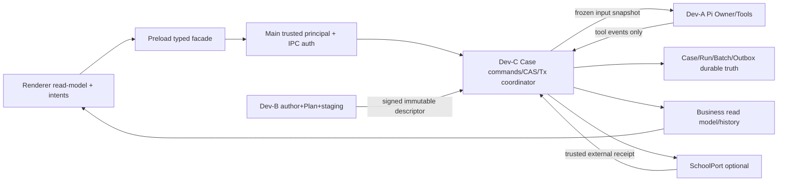

# 06｜V3领域对象、状态机、边界与可恢复事务合同

**所有名称是提议中的V3合同**，不是声称现行代码已经具备。保留V2 Cas/Receipt、ReviewRun等有意义名称；只引入必要的身份与协调字段。合约代号在03冲突索引中引用。

## A. 唯一职责表

| 实体/对象 | 当前写Owner / 存放 | 不可变/可变规则 | 读取者 |
|---|---|---|---|
| CaseAggregate, Subject, Observation, EvidenceLink, ReviewTask, Supplement, Rating, Recusal, Appeal, Decision | **Dev-C Main业务命令服务**（V2 CAS语义） | 单案CAS；事实历史和Receipt只追加，current applicability可更新；正式决策需要可信授权 | Renderer、Dev-A/B通过只读Snapshot |
| Template、PolicySource、ModuleVersion、AuthorDSL、原文 obligation、CoverageLedger | **Dev-B模板源仓** | 版本化作者态→校验→冻结→待发布→政策授权；不改旧publish | Dev-C安装/引用Plan |
| D2RuntimePlan、PlanFingerprint、Check×target/conditions | **Dev-B编译发布不可变工件；Dev-C安装引用与ACK** | 一旦绑定案卷不可由V1或模板热更新改写；升版建立新Plan | Dev-A运行快照、Dev-C业务 |
| RawBytes、SourceDocument、MaterialVersion、SourceRef、Block/Location | **Dev-B原件staging与解析owner；Dev-C决定当前采用版本** | 原件sha immutable；SourceRef含物理文档版本/parse版本/块坐标 | Dev-A只读tool、Renderer精确定位 |
| PiSession、Owner、ToolGrant、stop/revoke journal、execution events | **Dev-A Main Owner执行层** | 能力令牌绑定sender/case/attempt/expiry/generation；撤权立即封口 | Dev-C订阅验证事件 |
| ReviewRun、RunCheck、Coverage、ReadReceipt、InputManifest、Run finality | **Dev-C唯一持久Run writer**；Dev-A仅建议事件 | Run绑定frozenPlan、caseRevision、source versions、read ledger和工具回执，原Run只读 | Decision/Batch/Report |
| ImportBatch（多文件导入） | **Dev-B** 建立导入事务意图；Dev-C签收业务应用命令 | checkpoint/retry不意味审核完成 | 工作台/Dev-C |
| ReviewBatchAttempt、BatchCaseEntry、Group、triage、automation、finalize snapshot | **Dev-C** | 绑定BatchAttemptId/entryRunId/hash/revision/template；finalize只允许一次原子门禁 | 工作台/Dev-A执行计划 |
| OfflinePackage、Report、OutboxIntent、ExternalReceipt | **Dev-C业务权威**，外部port受授权 | 报告引用精确决策版本；校方回执等级单独记录 | 工作台/授权外部接口 |
| V1 case.json、legacy run@rev、旧输出 | **没有当前写owner** | 只读/影子迁移/审计tombstone，不自动转正式Run | HistoricalAdapter |

同一个命令可以涉及多个物理文件，但*不能有两个业务真值所有者*。Dev-B/Dev-A可以持有自己的工具状态/原始工件，不可写CaseAggregate或正式Decision。

## B. Canonical DTO（规范性草案）

```ts
type Principal = {
  principalId: string;
  source: "local" | "school";
  role: "reviewer" | "teacher" | "student" | "system";
  sessionId: string;
  assurance: "local-device" | "verified-school";
  credentialReference?: string; // 仅Main持有，绝不来自Renderer
  scope: {caseIds?: string[]; institutionId?: string; actions: string[]};
};
type AuthorizedCommand<T> = {
  caseId: string; requestId: string; expectedRevision: number;
  payloadHash: string; payload: T;
  // 主进程内部附加 principal；不接收Renderer actor
};
type SourceIdentity = {
  caseId: string; materialId: string; documentVersionId: string;
  rawSha256: string; parseRevision: string;
  blockId?: string; location?: {page?: number; rect?: number[]; sheet?: string; cell?: string; paragraph?: string};
};
type PlanBinding = {
  planId: string; canonicalPlanVersion: string; fingerprint: string;
  templateId: string; templateVersion: string; moduleDigests: string[];
  checks: Array<{checkKey: string; targetKey: string; objectKey: string;
    subjectId: string; condition: "applicable"|"not-applicable"|"unknown";
    conditionSourceVersion?: string; requiresSource: boolean;}>;
};
type RunIdentity = {
  runId: string; caseId: string; caseRevision: number;
  planFingerprint: string; templateId: string; templateVersion: string;
  inputManifestHash: string; sourceVersionIds: string[];
  checkKeys: string[]; ownerGeneration: string; executionAttemptId: string;
};
type BatchEntryBinding = {
  batchAttemptId: string; caseId: string; entryRunId: string;
  inputHash: string; planFingerprint: string; templateVersion: string;
  caseRevision: number; decisionId: string; decisionBasedOnRunId: string;
};
```

Legacy P06 scenario/旧target转换走`CanonicalPlanAdapter(legacyVersion)`：不支持的target/unknown条件必须明确 `UNSUPPORTED_PLAN_MAPPING`，保留原CheckKey引用和旧值，不可静默删项。D4六Check同构fixture为合同负例；`not-applicable`需规则证明，`unknown`永远不能算通过。

## C. Main可信命令与业务权限

Renderer→Preload仅发`intent+caseId+requestId+expectedRevision+payload`；`actor`键即使存在也丢弃/拒绝。Main先检查senderFrame/窗口绑定、已授权Owner、凭据/session真实性/有效期/机构范围，再派生不可由Renderer选择的Principal。领域服务再次逐条校验role、case/subject scope、状态机与expectedRevision，最后写入Receipt记录**Main派生**的principal provenance，不存可伪造的`actorSource=school`。

| 命令类 | 最低授权 | 事务/重复请求 |
|---|---|---|
| create/update/correct/link/material-activate | 可信本地reviewer + 本案scope；学校动作另按政策 | `requestId+payloadHash+expectedRevision`，同ID同payload重放同Receipt，异payload拒绝 |
| installPlan/upgradePlan | 模板有权编辑+案卷reviewer确认ACK；必须有差异 | 新plan版本/ack单独事件，旧FrozenPlan不变 |
| start/stop/read/revoke Pi | 窗口/Owner scope + tool grants；Owner代次核验 | 每次await回到写侧重验grant/generation |
| decide/appeal/score/recuse | 角色与阶段逐项领域gate；teacher必须可信school身份 | local reviewer不得进入teacher-gated resolveAppeal |
| batch preview/auto/group/finalize/outbox | 所属批次policy授权+精确成员/Run/Decision身份 | 最后提交时再次比较绑定和revision/hash |

拒止码建议稳定为：`ACTOR_UNTRUSTED`、`ROLE_FORBIDDEN`、`REVISION_CONFLICT`、`REQUEST_ID_PAYLOAD_CONFLICT`、`PLAN_IMMUTABLE`、`SOURCE_STALE`、`READ_RECEIPT_STALE`、`CHECK_COVERAGE_INCOMPLETE`、`RUN_IDENTITY_MISMATCH`、`BATCH_ATTEMPT_MISMATCH`、`OUTBOX_ACK_UNVERIFIED`、`RECOVERY_REQUIRED`；所有失败不产生虚假业务通过。

## D. 源/事实/决策有效性图

RawBytes(v1) immutable → MaterialVersion(v1) current/archived → SourceRef(v1,parseRevision,block) → Observation(value,originalConfirmed,sourceVersion) + EvidenceLink → ReadReceipt(Owner generation) → Check(source+target+plan) → Run(inputHash+coverage) → Readiness → Decision(basedOnRunId) → BatchSnapshot/Report/Outbox。

**归档 v1**：不删除v1字节、历史value、Receipt、旧Run或旧Decision；在CurrentValidity索引中撤销该版本关联的confirmed事实/链接/阅读有效性，将依赖的Check和Run标stale；新的Readiness必须拒绝旧源，不可自动复用通过结果。运行中途归档或模板升级导致Revision/InputHash变化时，提交Run和Decision都需重新CAS；旧Run只作为历史审计查看，旧已签业务决定标“历史当时有效”而不是物理删除。若相关字段没有可验证的来源version，fail closed并交人工确认。

## E. Run、Check与最终决定

1. Runner按Plan精确枚举全部`(checkKey,targetKey,objectKey,sourceVersion)`，accept/reject/missing/unknown四种过程状态明确。收到`finish=true`仍有缺Check即拒完结；执行失败不是业务不合格，零发现不等于全覆盖。
2. Dev-A仅执行工具并交付`EventEnvelope{attemptId,generation,sequence,toolReceipt,manifestHash}`；Dev-C验证每次read的case/source/sender/revoke generation和工具结果，写真实Run。跨案/伪造块/失效版引用不得进入confirmed Check。
3. 决策需模板published且校方政策适用性/权限满足、真实Run完成、Check目标覆盖、read receipts有效、无待办补件/申诉冲突、Run manifest与当前Case/Plan/Source匹配、主体评分/回避要求满足。D2“技术预审完成”不等同正式行政批准。
4. Batch最终化在同一Case/Batch写提交栅栏下要求entryRunId**非空**，和decision.basedOnRunId、run.caseId、run.template、inputHash、planFingerprint、revision、authorization全部精确相等；旧`done`无runId必须`LEGACY_UNBOUND`只读/人工处理。不能借用latestRun或删除拒止条件让流程顺滑。

## F. 跨文件事务、断电与Outbox

已有V2 CAS一次文件替换不能覆盖Batch snapshot、Run-store、Outbox独立文件的原子性；需有**持久commit intent/journal**和恢复门禁，不能宣称多文件的普通rename自动等价数据库事务。

建议单案/批次`TxId`全局唯一，写入前跨PID互斥/可验证lease+generation fencing（单进程内存锁不足）；`PREPARED`记录所有预期旧revision/old hash、拟写新内容hash、Outbox actionId；对每个文件写临时文件、fsync，按受保护顺序发布；完成后写`COMMITTED`且fsync目录。恢复遇`PREPARED/PARTIALLY_APPLIED`逐对象对照hash/revision：可幂等补齐则roll-forward，否则安全隔离为`RECOVERY_REQUIRED`，不显示已完成、不授权新的finalize；不要为了回滚而修改已可见不可变Receipt。只有确认业务commit持久化后才可派发Outbox。

Outbox状态：`intent-persisted → pending → delivery-attempted → provider-accepted → externally-acknowledged`，任意处可`failed/unknown/reconcile-needed`。mock只产生`mock-accepted`（与校方接收隔离），即使HTTP成功也未必行政受理。通过`actionId+payloadHash`幂等投递；无外部幂等接口则网络超时后**不得盲发**，先按受控receipt query对账，否则人工处理；不宣称外部exactly-once。删除/撤销Owner、Outbox冲突与断电阶段都要存首败hash、actor、技术错误与不影响业务真的恢复事件。

## G. 模块/信任边界图


边界包括Renderer/Main、Main/Pi、执行/原件、应用/持久化、Outbox/校方。重复校验是分层防御，不允许“去重”删掉最终写入栅栏。