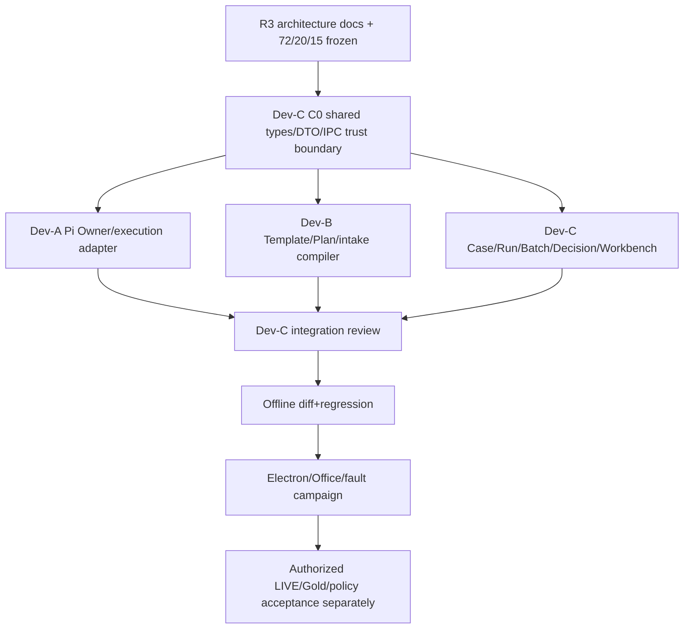

# 09｜三个开发会话的Owner、文件边界与串并行DAG

## 启动顺序（硬约束）

R3文档可提交并审查，**Dev-C C0必须先冻结**。禁止三个会话独立修改同名共享文件开始大批量工作。

## 唯一主责与写保护

| 线 | 唯一业务产出/所有权 | 允许的自有文件范围（例，实际改动先以C0 ownership manifest固定） | 禁止事项 |
|---|---|---|---|
| Dev-A | Pi Owner grant/revoke、hidden session、tool allowlist、ExecutionAttempt/permission journaling、stop/late event、Provider adapter、向Dev-C仅送RunDraft events | `review-pi-run-bridge`内专属adapter、agent integration、owner/session/permission service、自有测试和docs | 新建Case/Decision/Batch聚合，改shared IPC/type/CaseStore写逻辑；直接认为工具完成=审批准许 |
| Dev-B | Author DSL/Policy & Module、D1/D2/D3/D4 Plan compiler、raw source/revision parser、trusted staging、ImportBatch与保守路由，向C提供immutable descriptor | `review-d{1,2,3,4}-*`中经许可专属文件、template library、intake parser、实验/测试/文档 | 写V1/V2 Case真值、Run正式writer、学校政策假签、覆盖G04/G07缺义务、改共享IPC |
| Dev-C | CaseAggregate/Receipt/CAS、Main Principal/IPC、CurrentValidity、Run唯一提交、Decision/Appeal/Rating、ReviewBatch/Outbox、历史迁移、统一三栏工作台、共享类型和集成 | `case-store-v2`、`workspace-service-v2`、`review-ipc.ts`、`packages/shared`相关合同、preload、Renderer及跨线适配器 | 编造来自模板原文的义务、另造Pi Owner/校方身份、用fake role绕gate |

`review-ipc.ts`、`workspace-service-v2.ts`、`pi-case-review-service.ts`、shared types、Preload通用facade、CaseStore均为**Dev-C整合冻结文件**：Dev-A/B欲改动必须先提交`Adapter Change Request`包括目标事件schema、为什么单线adapter不够、CAS/安全影响、测试及最小目标patch，由C认可并在C分支实现；不得对共享文件的互相分叉直接cherry-pick。

## C0冻结合同交付门槛

`types/review-contracts`中固定`Principal,CaseCommand,CanonicalPlan,SourceIdentity,RunEvidenceIdentity,ExecutionEvent,BatchEntryBinding,OutboxReceipt`，Main IPC write/read矩阵及回调事件/错误码。以schema fixture与拒止测试为证，先签出C0 HEAD，Dev-A/B均以同一SHA建独立分支；不得用各自本地猜测的C0类型。C0是开发合同工程产物，R3报告自身不能代替它。

## 分支、提交与冲突处理

每线独立`worktree`与`feat/v3-dev-a-... / feat/v3-dev-b-... / feat/v3-dev-c-...`及Draft PR，提交前记录base/HEAD/changed-files/tests、前后SHA；不在原主仓未提交dirty tree操作、不force-push别人分支、不删/合并#129/#132/#133–#139。每轮开发内跑typecheck/boundaries/所属正反例和旧回归，截取首次失败日志；每几个功能批次统一锁SHA进行Electron+Provider集中验收，不能因集中验收跳过接口安全验证。

## 交接文件和批准协议

跨线合同变更必须提交`CHANGE_REQUEST {id,baseSha,owner,path,DTO-before/after,semantics,security,tests,backwardAdapter,rollback}`，由C审阅；变更后`contract-version`或fingerprint更新，A/B和C双方在同一集成SHA复跑。有争议退回R3裁决文件修订，不存在两个模块临时各说一个的"过渡"字段。