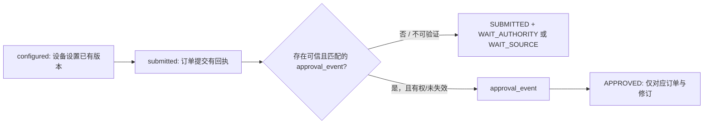

# G03 研究 E r04｜问题、互斥假设与实验范围

> 轨道：E v1.1 **研究性** EXP-04；结论范围：G03-T09 自动审批事件语义。不是正式 E0–E4 结果，不是首次盲审，不是大学行政审批。

## 0. 恢复与冻结前提

- 直接从只读 r03 提交 [75f2488b0cab5d9c0dfa5aaf6ecc43758c54cfb2](https://github.com/Fuck-GH-Admin/cdut-studio-review-agent/commit/75f2488b0cab5d9c0dfa5aaf6ecc43758c54cfb2) 派生本分支；未改写 r01/r02/r03。
- r03 源事实锁独立索引：`research/g03-e-v1p1-r03-source@ebc98c9e62860e35315e1259ac2d35bb42fa2d52`。本次从文件库原件计算 SHA-256：
  - `independent-source-register.md` = `aada81048c795b47de2f045e4f43d1853522254b2b243e6cd3722aafc8ad2327`，符合旧登记；
  - `adversarial-cases.md` = `f35b174e8e90ac303fee52cb528826049066a5a0f691ecfe4e1c868d73bb6884`，符合旧登记；
  - `source-lock.json` = `b1c2efe7f04bd23f6937c9063ad3f5b50219cb6587093809a5487e3a4bead094`，符合旧登记；
  - `G03-T09_正式业务模板_MD_v0.1.md` = `ca3195c16f7be049adbba5455393d1eb92bc7deda484721324784be7a1e720d0`，符合 r03 六件静态核验中 T09 的记录。
- 这些旧文件只是复核，没有倒签“独立源锁”，也没有把 r03 发现重新计为 r04 新发现。文件库原件与 GitHub 的公开摘要不同，不将公开摘要冒充完整文件。

## 1. 唯一高价值问题

**同一台设备、同一送样订单、同一提交修订、同一配置生效版本：仅改变“默认批准送样申请”开关和是否存在与该订单绑定的正式批准事件时，什么证据足以把官方状态从 SUBMITTED 写成 APPROVED？**

- H-CFG（待证伪）：设备开关 `autoApprove=true` 足以直接认定该特定订单 `APPROVED`。
- H-EVT（保留）：开关仅决定审批**路径**；具体订单只有出现可信的、有效范围内的 `approval_event` 才能认定为 `APPROVED`。
- H-C-DEFECT（对 C 的可证伪命题）：C-T09 存在“配置直接推导批准”的静态规则。该命题可由已冻结 C `R-29` / `11` 的实际条款直接检验。

**重要区分**：官方指南说明系统勾选后可以自动批准订单，并不表示某一笔尚未提交/尚无可核事件的订单已经获批。现实平台也可能即时自动生成事件，必须读取实际事件，不能预设系统一定延迟，也不能预设其日志格式。

## 2. 从源到规则的约束

- **F（官方原文的能力与设置语义）**：[成都理工大学大型仪器开放共享平台《设备信息录入操作指南》](https://dygx.cdut.edu.cn/genee/!upload/file/20250421165444_50685.pdf)，PDF 第 8 页/印刷第 7 页，“送样设置”第（3）项说明勾选默认批准后由系统自动批准、无需负责人审核，但建议不勾选；PDF 第 7 页/印刷第 6 页第（1）项要求上传附件是独立可配置开关，按实际情况勾选。建议不是禁用义务，也不是现实开关值。
- **已冻结 C 静态规则**：`G03-T09` `R-29`（原件约第 435–440 行）明确“批准事实始终来自正式审批事件”“true但无事件→WAIT_AUTHORITY”；`11` 第 504 行同样要求真实订单批准事件。只证明规则文本，不等于实现正确。
- **S（封闭模拟）**：实验设备/订单/订单版本/配置版本、事件真伪、权限等均为合成测试条件。“有权、可信、可关联”的具体判定函数是研究用最小契约，不冒充真实平台事件验证器。
- **U（2026 现实未核）**：设备当期设置、订单提交日志、完整审批/撤销事件、事件出具主体及 ACL、原始来源完整性、2023-13 正文与其他专业安全义务。

## 3. 对照矩阵与反事实

在合成条件中固定 `device_id=SYNTH-DEVICE-01`、`order_id=SYNTH-ORDER-01`、`order_revision=order-r1`、送样模式及附件开关为 false。

| 开关 | 订单已提交 | 可信批准事件 | S 预期官方状态 | 是否支持 H-CFG |
|---|---|---|---|---|
| false | 是 | 无 | SUBMITTED，待有权审批 | — |
| true | 是 | 无 | SUBMITTED，待有权审批 | **否** |
| true | 是 | 有，自动批准且匹配对象/版本/时间 | APPROVED | 仅事件使其成立 |
| false | 是 | 有，授权人工批准且匹配 | APPROVED | 事件可独立证明 |
| true | 是 | 有，但属于另一订单/旧修订/提交前事件 | SUBMITTED，待核 | **否** |
| false | 是 | 标称自动批准、与有效配置矛盾 | SUBMITTED，待核冲突 | **否** |

最小反事实：保持其他事实不变，`auto=false→true` 且**仍无审批事件**，不能使状态跳到 APPROVED；在 `auto=true` 时仅增加可信、对象绑定且时序合法的正式审批事件，方可完成跃迁。不可用合成 `attested=true` 代替真实权限审计。

## 4. 状态机

此流程不将“APPROVED”解释为已收样、已完成技术安全复核、已收费或可立即开机；这些属于其他独立阶段。

## 5. 可接受的研究结果

1. 已冻结 C 明确分离配置与审批事件，则排除所指**静态**误映射；不臆造 C/Pi 实现的运行表现。
2. 用公开、安全、确定性的合成序列做最小契约回放，标为 **S / CONTRACT_ONLY**。
3. 缺少平台授权与可信实际事件时，把剩余 U 精确交给有权大仪平台管理员；不读取隐藏 Gold、不测真实个人订单、不对外暴露事件 URL。
4. 所有 E v1.0 放行门、旧 T06 Gold 独立性与 T10 版本指针沿用旧审计结论，不在本轮偷渡关单。
