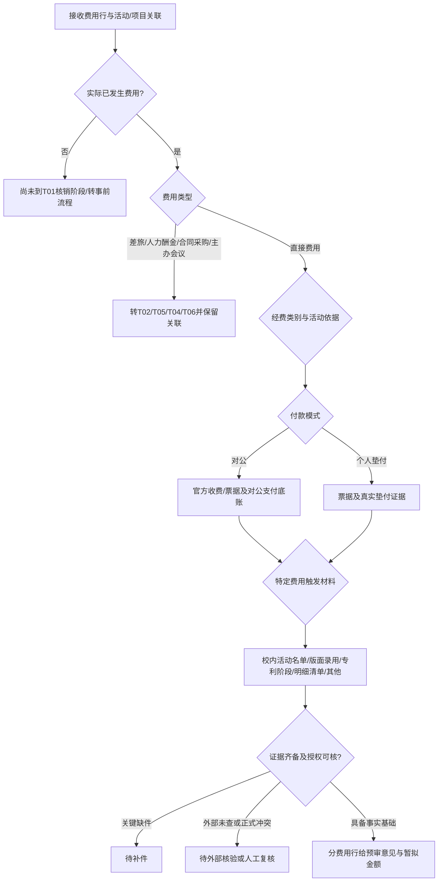

# G07-T01｜办理情景树与条件轴（B阶段研究）

> 只描述有官方材料支持的场景及高风险交叉；`S`编号是**研究场景ID**，并非D阶段的测试题号。每个分支均仍属G07-T01的同一“直接费用核销”审核目的，除明确须转办者。

## 1. 组合逻辑：先正交选条件，再选择对应证据组

| 条件轴 | 枚举值（研究发现） | 是否互斥 | 如何影响材料/判断 | 来源 |
|---|---|---|---|---|
| A0 当前是否真的发生费用 | 已产生有效支出 / 仅事前预算或报名意向 | **是** | 后者不是T01事后核销，返回“尚未形成票据”或分流事前授权；不能判票据缺失 | [EX-B02][EX-B07] |
| A1 费用类别 | 竞赛报名 / 学生活动食品或奖品 / 文印宣传或邮寄 / 科研办公或成果版面/专利 / 其他需分流 | 单笔费用行互斥、申请多行可并存 | 分类后确定主证明事实、费用允许科目 | [CD-B01][EX-B01] |
| A2 付款模式 | 统一对公 / 学生本人垫付 / 教师或第三人垫付 / 未实际支付 / 混合支付 | 单笔付款渠道按交易分，整案可组合 | 对公不能强索个人流水；垫付核授权、净实付 | [EX-B01][EX-B02][EX-B09] |
| A3 资金类型 | 学生活动经费 / 竞赛专项 / 纵向科研 / 横向科研 / 自筹非报销 | **单笔经费来源按分摊记录** | 不同项目可支持同一活动不同费用行，但同笔不能重复取得赔付 | [CD-B01][EX-B01] |
| A4 经办角色 | 直接授权教工 / 学生材料提供人 / 学生垫付收款人 / 部门批量经办 | **角色可兼任** | 核学生是否可提交、老师项目授权、报销款实际收款人 | [EX-B05][EX-B01][CD-B02] |
| A5 活动关系 | 校内组织 / 参赛省赛、国赛或多个阶段 / 科研任务/论文 / 独立个人消费 | 可叠加阶段 | 通知、名册、成果、票据需是同一届与同阶段 | [CD-B01][EX-B01] |
| A6 时间与制度 | 活动前审批 / 费用发生 / 开票 / 申请 / 补件 / 财务核准 / 支付；政策生效版本 | 日期各不等 | 不得把补开发票日误作活动日；2025票据跨2026过渡条件 | [CD-B01][CD-B02] |
| A7 例外 | 票据金额未有详细品目 / 票据损失 / 已退款/红冲 / 外文票据 / 授权代付 / 缺系统接口 | 多条件可叠加 | 触发等效证明、退费金额重算、人审，不机械一票否决 | [CD-B01][EX-B03] |

## 2. 有证据支持的可执行研究场景树

| 场景ID | 入口与本次提交目标（申报事项） | 申报材料（核心文书） | 证明材料与可选等效组合 | 当前阶段/责任方 | 不同结果及误杀风险 | 依据 |
|---|---|---|---|---|---|---|
| S01 | 已举行校内学生活动、申请日常支出 | 费用报销单、学生活动明细表**或**活动事项说明 | 合格票据；活动时段/人数及组织归属记录 | 活动结束、学生/老师经办→负责人财务 | 未上传两种说明中的某一种不等于缺证，内容齐全即可 | CD-B01 P8 |
| S02 | 校内学生活动就餐、购买水果食品 | 报销费用行/人数说明 | 原始票据、购买清单、学生就餐/领取签名或名单；活动情况 | 活动后、按学校活动资助规定审 | 按CDUT2025特定“原则”人均控制；不套到科研版面费 | CD-B01 P8 |
| S03 | 学生活动有奖品/获奖物资需报销 | 费用行/批准预算说明 | 奖品购买票、物品明细、签收表、核奖名单、库存说明（若有） | 活动后 | 历史党建活动的奖品签字要求可作关联；普通奖品不能强制照搬北师大数量限额 | CD-B01 P7；EX-B02 |
| S04 | 学校统一对公缴付竞赛报名费 | 支付/核销单、赛项/经费关联说明 | 正式竞赛通知、报名费发票、盖章参赛名单；校财务对公付款台账 | 竞赛已报名/费用发生，学校支付 | 学生无个人流水应**无罪**；有借款时T07冲账状态引用 | EX-B01 |
| S05 | 参赛学生团队个人先垫付报名费 | 费用报销单、垫付及收款说明 | 赛项通知、报名费发票、官方名单、缴费情况说明和学生→主办方的支付记录 | 竞赛相应阶段结束后 | 若授权或缴费事实不明，补证；有真实第三方代付可做关系审核 | EX-B01 |
| S06 | 省赛→国赛两个阶段竞赛经费 | 分阶段费用单/费用归属说明 | 赛事阶段通知、每阶段名单、各阶段对应的不同原始票据/支付记录 | 阶段已结束 | **常州按赛段一事一报**，不能仅用“同赛名”判重复；CDUT2025学生活动同次一次报销条件另配 | EX-B01；CD-B01 P8 |
| S07 | 竞赛作品邮寄、印刷制作、展示资料 | 费用行、用途及项目关联说明 | 邮寄面单/运单、设计服务明细或商品单、相关发票、付款/交付证据（适用时） | 支出发生且服务交付 | 如果触发采购合同/验收，则路由T03/T04，不能让T01跳过该条链 | EX-B01；EX-B03 |
| S08 | 校内科研日常办公与小额印刷 | 费用行及科研任务/预算说明 | 发票、对方盖章清单（票面不能反映明细且达到对应条件时）、账务记录 | 费用发生 | CDUT2025单张**500元以上（通常含500元）且无商品明细**触发；实际使用时应先确认该历史规则是否仍适用 | CD-B01 P3；CD-B03 |
| S09 | 国内论文版面费 | 版面费报销单、论文与经费关联说明 | 票据 + 录用通知**或**已发表文章首页 | 录用/缴费后 | 不应因为论文尚未正式刊发便机械拒付；具体科研项目预算另核 | CD-B01 P3；EX-B03 |
| S10 | 境外论文版面费/公开发表收费 | 版面费报销单、外币支出说明 | 录用、invoice/receipt、翻译及汇率确认、适用税务证明；付款证据按渠道 | 结算/必要外汇流程 | 需要外事/财务权威确认；不要求国际会议的出国审批 | CD-B01 P3；EX-B09 |
| S11 | 科研专利申请费/年费 | 专利支出报销行、纵横向经费性质说明 | 票据、专利受理/授权证书等相应阶段证明；纵向预算任务或盖章合同（依适用规则） | 受理/授权/续费对应时点 | 申请费有受理状态即可产生费用，不能强制“已授权”；科研成果权属另交G06 | CD-B01 P10；CD-B04 |
| S12 | 被要求由个人垫付的科研业务/直接费用 | 报销单、代垫和费用归属说明 | 票据、交易详情、合法委托/授权、受款账户登记 | 报账前 | 代付人与学术作者不同可能合法；四川大学2026中心的垫付流水不作为CDUT强制规则 | EX-B09；EX-B01 |
| S13 | 同一费用已有退款/部分退费 | 费用行及退款说明 | 原票/支付、红票或退款记录、合法剩余费用 | 退款后结算/复核 | 可核净额，不把全部费用统一判作0；若税务状态不可达则待核验 | EX-B03；研究推导 |
| S14 | 历史同票据在另一项目已核销 | 新申请单 | 票据、部门/财务历史核销记录(R) | 申请时系统查询 | 去重应查同一经济事实与已报金额，不能仅用文件名/摘要判重复 | CD-B01 P14；风控建模推导 |
| S15 | 票据遗失但有正式替代及层级批准 | 报销单、丢失原因/补证说明 | 原开票单位存根盖章复印件，或按2025规则的开票方证明及学校审批 | 事后异常补件 | 有权批准的例外不能一律驳回；只有个人自述不等同完整替代 | CD-B01 P14 |
| S16 | 2025有效票据到2026跨年重报 | 新系统报销申报单 | 原有效票据、2025旧预约是否未投递、2026新单 | 2026过渡 | 2025票据原则2026一季度内报销，需核特殊延迟批准；不能作为永久窗口 | CD-B02 |
| S17 | 同活动费用行有报名费、差旅、奖金及采购合同 | 一个活动总说明（或多个关联申请） | 分行票据，差旅T02，奖金T05，合同履约T04，可能有借款T07 | 事后业务路由 | **允许拆申请的审核目的，不允许同票双核销**；不要“一类不适用就全案驳回” | CD-B01 P2/P8/P10；EX-B01 |
| S18 | 仅已获活动前预算/竞赛报名意向，无实付费用 | 费用预算/活动策划 | 事前批准、拟购清单、赛项通知 | 事前 | 此时不属于T01成熟报销，不应输出“必交已开发票”；引导事前授权或等待实际费用 | EX-B02；EX-B07 |

## 3. 分支依赖树：按条件选择材料而非组合爆炸

### 3.1 两组已确认的“不能混为相同规则”的差异

- **CDUT2025活动一次报销**[CD-B01] vs **常州工学院2026竞赛省/国赛阶段分报**[EX-B01]：需要按学校、活动/赛项、费用行及政策版本区分，非跨校强制统一。
- **CDUT2025直接费用明细可替代**[CD-B01] vs **北师大心理学部2025活动前需《审批表》活动前部分、活动后再补后半部分**[EX-B02]：不能因为“学生活动”四字就对科研支出强制索该学部表格。

## 4. 时间点的八个对象（后续C不能省略）

`event_start/end`、`preapproval_at`、`charge_due_at`、`transaction_at`、`invoice_issued_at`、`claim_submitted_at`、`accounting_approved_at`、`bank_paid_at`。同一事件可能跨赛期/跨自然年度。需要区分“先发生实际支出，事后补录”与“过去有效旧预约未投递而必须在2026新系统重报”的情况。[CD-B02]

## 5. 条件组合审计：8个高风险交叉

1. 学生垫付 + 一张联合报名费发票 + 多名团队成员；核付款和收款，不强求每人一张发票。
2. 对公报名费 + 暂借款冲销 + 无学生流水；转T07完成借款核销关系。
3. 活动餐食 + 超人均/部分名单缺签；允许按人数/品类分项疑点，而非放过或整案拒。
4. 两届同名赛事 + 两个独立票号；不能仅用赛事名称去重。
5. 省赛、国赛两个报名阶段 + 同一学生团队 + 两笔不同报名交易；以学校阶段规则定可报。
6. 国内论文已录用未正式见刊 + 编辑部合法收费；不能把综测“论文正式发表”的奖励条件迁到版面费。
7. 国外版面费 + 法定税务与币种核算 + 委托机构代收；无法证实收款授权时待核而非自动标伪。
8. 奖品采购总数、领用总数与活动实际参加人数不一致；库存/未发放结余可以解释差额，不能只看一张照片。
