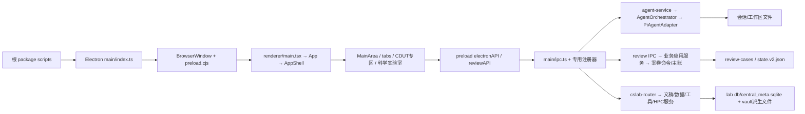

# CDUT Studio：当前代码与文档导航图

基线：`05fb2565e20eb1760233696be1832f68196b37c2`，源码根为 `baseline/source/`。本图回答“入口在哪里、调用跨过哪些边界、谁掌握业务数据、到哪里继续读”。**证实**表示在冻结源码上静态实读；**推断**表示由源码推导；Electron、模型、网络、Worker、Python、HPC 的真实运行均 **NOT_RUN**。

前置索引已由独立复审通过：[INDEX gate](VERIFICATION/GATES/INDEX.json)。[全量对应表](INDEXES/SOURCE-TO-DOCUMENT.tsv) 枚举 **3083** 个不同的真实跟踪文件：**2378 deep + 705 index-only**。2026-10-23 21:46:51 UTC 首次独立索引快照中 **2260 deep 已接受、118 deep 为已发布 stage 但尚未接受、705 index-only 已接受**；后续接受动作须看全局台账，不能把此快照视作实时计数。[索引报告](INDEXES/REPORT.md) 逐一绑定源 blob/SHA256、文档实际 SHA256、归属与接受状态；历史旧 922 不构成本轮权威。

## 1. 从产品入口到代码

图中的箭头为静态调用/装配关系，不表示所有模块启动时立即运行。构建入口 [package.json:16](SOURCE/package.json) 把 dev 交给 Electron workspace；[apps/electron/package.json:17](SOURCE/apps/electron/package.json) 将 `src/main/index.ts` 打成 `dist/main.cjs`，`:21` 将 preload 打成 `dist/preload.cjs`，`:28` 单独构建 renderer。精确调用边见下文。CURRENT-ARCHITECTURE、BUSINESS-FLOW、DESIGN-VS-IMPLEMENTATION 是后续解释入口；本图提供源码定位。

## 2. 物理目录与逻辑归属不是同一层

| 真实边界 | 主要责任与下一跳 | 阅读入口 |
| --- | --- | --- |
| `apps/electron/src/main/` | Electron 生命周期、IPC、文件与网络能力；大部分产品业务落在 `lib/` | [index.ts:903](SOURCE/apps/electron/src/main/index.ts)、[ipc.ts:1322](SOURCE/apps/electron/src/main/ipc.ts) |
| `apps/electron/src/preload/` | 把 typed JS API 映射为 Electron invoke/on，renderer 通过 window 使用 | [index.ts:2904](SOURCE/apps/electron/src/preload/index.ts)、`:4705/:4738/:5099` |
| `apps/electron/src/renderer/` | React UI、Jotai atoms、hooks、页内交互；不是落盘权威 | [main.tsx:1123](SOURCE/apps/electron/src/renderer/main.tsx)、[App.tsx:26](SOURCE/apps/electron/src/renderer/App.tsx) |
| `apps/electron/src/types/` + `packages/shared/src/` | Electron 设置类型/通道与跨包业务类型、共享纯规则；并非只把通道集中在一个文件 | [settings.ts:410](SOURCE/apps/electron/src/types/settings.ts)、[shared/index.ts:5](SOURCE/packages/shared/src/index.ts) |
| `packages/core/src/` | provider 抽象、浏览器安全根入口；PDF/Office Node 能力从 subpath 导入 | [core/index.ts:1](SOURCE/packages/core/src/index.ts)、[core/package.json:9](SOURCE/packages/core/package.json) |
| `packages/session-core/src/` | 会话解析、归一、快照/转录纯函数；IO 位于 `/node` 子入口 | [session-core/index.ts:1](SOURCE/packages/session-core/src/index.ts) |
| `packages/project-core/src/` | headless 任务图与项目元数据的纯函数 | [project-core/index.ts:1](SOURCE/packages/project-core/src/index.ts) |
| `packages/agent-fabric/src/` | Fabric 协议、能力、节点、任务、状态机与 gateway；Electron 装配在 main/lib/agent-fabric | [agent-fabric/index.ts:1](SOURCE/packages/agent-fabric/src/index.ts)、[agent-fabric-service.ts:10](SOURCE/apps/electron/src/main/lib/agent-fabric/agent-fabric-service.ts) |
| `packages/ui/src/` | 共享 primitives、Markdown、代码块、Mermaid、交互 hooks | [ui/index.ts:5](SOURCE/packages/ui/src/index.ts) |
| `apps/cli/src/` | 独立命令行会话读取入口，注册 list/info/outline/search/export | [cli/index.ts:17](SOURCE/apps/cli/src/index.ts) |
| `packages/benchmark-multihop/` | 独立 MultiHop-RAG 评测服务/看板，不是主 Electron 启动入口 | [package.json:5](SOURCE/packages/benchmark-multihop/package.json) |
| `apps/electron/default-skills/` | 内置 skill、Office/PDF 脚本、schemas 等能力资源；加载后会约束 Agent 行为，不能视为普通说明文档 | [index.ts:939](SOURCE/apps/electron/src/main/index.ts)、[config-paths.ts:956](SOURCE/apps/electron/src/main/lib/config-paths.ts) |
| `apps/electron/resources/`、`scripts/`、`patches/`、`.github/` | 打包资源、开发/发布检查、上游补丁和工作流 | [electron-builder.yml:44](SOURCE/apps/electron/electron-builder.yml)、[package.json:61](SOURCE/package.json) |
| `docs/`、`specs/`、`tutorial/`、`work/`、`.context/`、`assets/`、`demo-data/` 等 | 设计/过程/教程/演示与资源；是否被程序加载必须按每文件索引的消费边判断 | [全部物理目录归属表](DIRECTORY-OWNERSHIP.tsv)、[705项所在的完整导航](INDEXES/REPORT.md) |

`p01` 至 `p08` 是本轮文档业务分区，**不是八个独立 npm 包**。例如 `main/lib/review/` 的文件分归 p04/p05/p06，p08 汇集 renderer 与 UI，不能用文件夹名字推断接受归属。全部物理前缀及 owner 交集由 [DIRECTORY-OWNERSHIP.tsv](DIRECTORY-OWNERSHIP.tsv) 从逐文件注册表生成。

| 文档归属 | Deep | Index-only | 全部逐文件导航 |
| --- | ---: | ---: | --- |
| p01-app-shell | 297 | 439 | [应用壳、构建、设置与资源](INDEXES/p01-app-shell.md) |
| p02-agent-runtime | 355 | 173 | [Agent 运行时、工具、内置能力](INDEXES/p02-agent-runtime.md) |
| p03-integrations | 272 | 7 | [外部集成、实验室与周边服务](INDEXES/p03-integrations.md) |
| p04-review-case-core | 108 | 0 | [审核案卷与新权威核心](INDEXES/p04-review-case-core.md) |
| p05-review-engine | 191 | 3 | [审核引擎与业务服务](INDEXES/p05-review-engine.md) |
| p06-review-batch | 80 | 0 | [批次与配套审核服务](INDEXES/p06-review-batch.md) |
| p07-shared-libs | 294 | 0 | [共享包与公共逻辑](INDEXES/p07-shared-libs.md) |
| p08-renderer-ui | 781 | 83 | [渲染层、共享界面与界面资源](INDEXES/p08-renderer-ui.md) |

## 3. 启动、窗口与 UI 导航

1. **主进程先隔离 userData，再取得单实例锁**：[main/index.ts:45](SOURCE/apps/electron/src/main/index.ts) 解释顺序，`:49` 调用 `app.setPath`；`:64` 取得锁。Electron userData 与业务配置根属于两套路径机制，不应混用。
2. `app.whenReady().then(bootstrap)` 在 [main/index.ts:903](SOURCE/apps/electron/src/main/index.ts)。bootstrap 中初始化 runtime（`:930`）、注入全局技能 bundle 来源（`:939`）、注册 IPC（`:945`）、**仅真实应用启动安装 C11 本地 Main 权威能力**（`:948` 至 `:951`），再创建主窗口（`:991`）。窗口之后才依次执行全局 Skill 迁移、预设准备和旧 seed（`:997` 至 `:1001`）。只注册 review IPC 的测试不自动获得这四项安装能力。
3. 主窗 [main/index.ts:475](SOURCE/apps/electron/src/main/index.ts) 创建，`:514` 挂接 `preload.cjs`；开发模式等待 Vite 并 `loadURL`（`:692/:721`），打包模式 `loadFile`（`:716`）。主窗 move/resize 经 500ms 防抖写 settings.mainWindowState（`:457/:757/:767`），不是由 renderer 自行保存窗口位置。
4. [renderer/main.tsx:1059](SOURCE/apps/electron/src/renderer/main.tsx) 起存在 detached preview、planning 等独立窗口分支；主入口在 `:1123` render App。App [App.tsx:38](SOURCE/apps/electron/src/renderer/App.tsx) 先经 preload 读取设置、决定 onboarding；加载状态提交后 `notifyRendererReady`（`:58`），正常界面挂接 AppShell（`:118`）。
5. [AppShell.tsx:264](SOURCE/apps/electron/src/renderer/components/app-shell/AppShell.tsx) 组合 MainArea。[MainArea.tsx:321](SOURCE/apps/electron/src/renderer/components/tabs/MainArea.tsx) 依据 `activeView` 切 planning/agent-skills/cdut-zone/cdut-science；普通会话落到 TabContent。[TabContent.tsx:60](SOURCE/apps/electron/src/renderer/components/tabs/TabContent.tsx) 用 sessionId 渲染 AgentView。材料审核不是 MainArea 的独立一级分支：CDUT 专区 [CdutZoneView.tsx:330](SOURCE/apps/electron/src/renderer/components/cdut-zone/CdutZoneView.tsx) 才挂 ContentReviewView。

## 4. IPC 边界与“接口存在”之外的约束

**常规方向**：React handler → `window.electronAPI`/`window.reviewAPI` → preload `ipcRenderer.invoke(共享常量, 参数)` → main `ipcMain.handle(同一常量)` → 应用服务。**事件方向**：main/webContents.send → preload listener → renderer hook/atoms；不把 invoke 返回 Promise 当成全部流事件。

- 通用注册器 [ipc.ts:1322](SOURCE/apps/electron/src/main/ipc.ts) 在 `:6220/:6223/:6226` 调用 review、CsLab、longterm-memory 注册器；review 再在 [review-ipc.ts:110](SOURCE/apps/electron/src/main/lib/review/review-ipc.ts) 注册 CMain V3 author/plan 专用 IPC。共享契约入口是 [packages/shared/src/index.ts:5](SOURCE/packages/shared/src/index.ts)，settings 等 Electron 专有通道另在 [types/settings.ts:410](SOURCE/apps/electron/src/types/settings.ts)。
- **帧边界必须准确**：[preload/index.ts:4705](SOURCE/apps/electron/src/preload/index.ts) 的 electronAPI 暴露没有主帧门；agentPreviewAPI（`:4738`）与 reviewAPI（`:5099`）处于 `process.isMainFrame` 条件内。不能从 contextBridge 的存在推断每个 main handler 已验证发送方，也不能将三者都写成主帧限定。
- 配置 GET：preload `:2529` → [ipc.ts:2177](SOURCE/apps/electron/src/main/ipc.ts) → [settings-service.ts:45](SOURCE/apps/electron/src/main/lib/settings-service.ts)。UPDATE 在 [ipc.ts:2197](SOURCE/apps/electron/src/main/ipc.ts) 去除审核代批敏感字段；专用确认通道在 `:2185`。
- Agent 发送：renderer [AgentView.tsx:1481](SOURCE/apps/electron/src/renderer/components/agent/AgentView.tsx) → preload [index.ts:2904](SOURCE/apps/electron/src/preload/index.ts) → [ipc.ts:3842](SOURCE/apps/electron/src/main/ipc.ts)。此 handler 首先 `assertSensitiveAgentIpcSender`、检查 sessionId、拒绝非普通会话，再协调工作区/渠道/预设与运行（`:3844` 起）。
- 审核具有独立 Main 权威与 actor 绑定；旧通道在冻结 CanonicalPlan 后不得并行改写：[review-ipc.ts:86](SOURCE/apps/electron/src/main/lib/review/review-ipc.ts)。这是业务写权约束，不能以 UI 禁用按钮代替。

## 5. 普通 Agent、模型与后台 Fabric 的依赖路径

**已证实的普通对话运行路径**：上述 SEND_MESSAGE → [agent-service.ts:277](SOURCE/apps/electron/src/main/lib/agent-service.ts) `runAgent` → `orchestrator.sendMessage`（`:297`）→ [agent-orchestrator.ts:2554](SOURCE/apps/electron/src/main/lib/agent-orchestrator.ts) `adapter.query(queryOptions)`。实际服务在 [agent-service.ts:54](SOURCE/apps/electron/src/main/lib/agent-service.ts) 构造 **PiAgentAdapter**，不能把历史 Claude 注释或接口兼容类型当作另一条已启用默认路径。

编排器不是只做模型调用。它导入 runtime credentials（[agent-orchestrator.ts:71](SOURCE/apps/electron/src/main/lib/agent-orchestrator.ts)）、工作区/session、模型路由（`:142`）、prompt builder（`:134`）、长期记忆/RAG（`:173` 至 `:178`）、技能准备（`:123` 至 `:125`）、权限服务（`:138/:1745`）与 MCP tools（`:185`）。模型/provider 归一和实际调用适配继续读 [pi-model-registry.ts:233](SOURCE/apps/electron/src/main/lib/adapters/pi-model-registry.ts)、[pi-agent-adapter.ts:2531](SOURCE/apps/electron/src/main/lib/adapters/pi-agent-adapter.ts)。这些是责任/消费边证据，不代表每一条 fallback 已经运行验证。

事件回程由 [agent-service.ts:234](SOURCE/apps/electron/src/main/lib/agent-service.ts) `emitSessionStreamEvent` 等服务面承接；preload [index.ts:3079](SOURCE/apps/electron/src/preload/index.ts) 订阅 stream event/complete/error，renderer [useGlobalAgentListeners.ts:1336](SOURCE/apps/electron/src/renderer/hooks/useGlobalAgentListeners.ts) 集中订阅并更新状态。停止入口 [agent-service.ts:566](SOURCE/apps/electron/src/main/lib/agent-service.ts) 转交 orchestrator，后者 [agent-orchestrator.ts:3698](SOURCE/apps/electron/src/main/lib/agent-orchestrator.ts) 调 adapter.abort；实际取消时延和进程/工具清理未实跑。

**Fabric 是另一层调度入口，不是第二种模型 provider**。[agent-fabric-service.ts:80](SOURCE/apps/electron/src/main/lib/agent-fabric/agent-fabric-service.ts) 配置未 enabled 时直接返回；启用后组装文件任务/事件 store、headless executor、Gateway（`:90` 至 `:101`），经 [fabric-server.ts:189](SOURCE/apps/electron/src/main/lib/agent-fabric/fabric-server.ts) 的 HTTP server 提供传输。普通后台运行入口 [agent-service.ts:404](SOURCE/apps/electron/src/main/lib/agent-service.ts) 的 `runAgentHeadless` 同样在 `:422` 进入 orchestrator；具体 Fabric executor 如何组装输入须继续读对应 per-file 手册，不把所有 gateway 字样归成同一条链。

## 6. 审核业务：旧展示与新主账同时存在

UI 从 CDUT 专区进入 [ContentReviewView.tsx:69](SOURCE/apps/electron/src/renderer/components/content-review/ContentReviewView.tsx)。主进程 [review-ipc.ts:107](SOURCE/apps/electron/src/main/lib/review/review-ipc.ts) 是登记入口；其 imports 明确同时消费 `case-store`、`application-service` 的动态分支、`workspace-service-v2`、`case-store-v2` 与 `native-workspace-case-v3`（`:38` 至 `:69`）。因此“review 目录中的最后版本数字”不是数据权威选择规则。

- 旧案卷/展示兼容路径：[case-store.ts:39](SOURCE/apps/electron/src/main/lib/review/case-store.ts) 给出 `<config>/review-cases/<caseId>/case.json` 与 runs；`:207` 可见它读取 state.v2 状态。旧 case.json 不能一概说成所有新业务的唯一主账。
- 新聚合主账：[case-store-v2.ts:31](SOURCE/apps/electron/src/main/lib/review/case-store-v2.ts) 为 `state.v2.json`；`:51` 的读恢复能回退上一有效主账但不伪造 revision；`:203` 的 `submitCommand` 在逐案队列/写锁体系内核对 requestId/payloadHash（`:228`）、expectedRevision（`:232`）、状态迁移，再 revision+1 并写回（`:251/:258`）。
- 写入委托：[case-store-v2.ts:167](SOURCE/apps/electron/src/main/lib/review/case-store-v2.ts) 经过 `withC2CaseDiskWriteSync` 与 `writeC2CaseStateDurably`。不要把此主账写入描述成普通 settings.json 的直接覆盖。
- 业务授权分流：[review-ipc.ts:86](SOURCE/apps/electron/src/main/lib/review/review-ipc.ts) 禁止被 CanonicalPlan/T07 替代的旧兼容写继续生成平行权威；真实 bootstrap 安装的 C11 能力又与只注册 IPC 的独立测试区分。新模板、物理材料接入、计划与评分的细节按 p04/p05/p06 逐文件导航继续读。

审核模型建议、观察、方案、评分与最终处置并非同一件事；本图只确认其存储与入口分层。每一条 review IPC 的输入/输出与 actor 前置条件由 API 文档继续展开，未在这里声称逐通道动态验证。

## 7. 科学实验室、文件、Worker 与外部执行

[ipc.ts:6223](SOURCE/apps/electron/src/main/ipc.ts) → [cslab-router.ts:391](SOURCE/apps/electron/src/main/lib/cslab/cslab-router.ts) 是实验室 IPC 入口。实验室路径由 [cslab-paths.ts:114](SOURCE/apps/electron/src/main/lib/cslab/cslab-paths.ts) 解析；文稿服务 [cslab-manuscript.ts:50](SOURCE/apps/electron/src/main/lib/cslab/cslab-manuscript.ts) 打开 `<lab>/db/central_meta.sqlite`，数据库 [cslab-db.ts:122](SOURCE/apps/electron/src/main/lib/cslab/cslab-db.ts) 建立 entities、provenance_edges、tables、manuscripts、runs 等表，`:307` 提供显式事务。

| 业务入口 | 关键依赖与落点 | 必须保留的边界 |
| --- | --- | --- |
| 保存文稿 [router:705](SOURCE/apps/electron/src/main/lib/cslab/cslab-router.ts) | [manuscript:244](SOURCE/apps/electron/src/main/lib/cslab/cslab-manuscript.ts) 先写 Markdown/sidecar（`:264`），后 DB 事务更新文稿/胶囊/图边（`:274`） | 文件与 DB 不在同一事务内；不能宣称全链原子 |
| 关联/导出 Word | [manuscript:392](SOURCE/apps/electron/src/main/lib/cslab/cslab-manuscript.ts) attachDocx 复制到沙箱；`:417` 写长期副本；`:430` 导出独立件 | 原导入文件、沙箱 linked 副本、export 副本是三个不同对象 |
| OOXML 计算 | [cslab-ooxml.ts:1120](SOURCE/apps/electron/src/main/lib/cslab/cslab-ooxml.ts) 寻找 worker bundle；存在则 Worker，30s timeout terminate | bundle 缺失时退回进程内执行，不能总称线程隔离；无显式取消 API |
| Python 工具 | [cslab-python-runtime.ts:372](SOURCE/apps/electron/src/main/lib/cslab/cslab-python-runtime.ts) execFile；[cslab-tool-registry.ts:570](SOURCE/apps/electron/src/main/lib/cslab/cslab-tool-registry.ts) 带 lab cwd 执行 | 解释器/脚本来源与 timeout 分支分别检查；agent 工具确认门不等于 IPC 路径同样有门 |
| HPC | [router:1654](SOURCE/apps/electron/src/main/lib/cslab/cslab-router.ts) → [cslab-hpc.ts:123](SOURCE/apps/electron/src/main/lib/cslab/cslab-hpc.ts) 等守卫/提交链；[cslab-hpc-db.ts:121](SOURCE/apps/electron/src/main/lib/cslab/cslab-hpc-db.ts) 独立 per-lab DB | 远端写入、MFA、调度状态与本地记录分层；完整取消/恢复仍待验 |
| 导出图像 | [router:1791](SOURCE/apps/electron/src/main/lib/cslab/cslab-router.ts) → [cslab-science.ts:194](SOURCE/apps/electron/src/main/lib/cslab/cslab-science.ts) → [cslab-figure-export.ts:183](SOURCE/apps/electron/src/main/lib/cslab/cslab-figure-export.ts) | 用户保存对话框选择的外部输出是正常导出落点，不能一概说所有写入都留在 lab 沙箱 |

路径包含性检查见 [cslab-paths.ts:320](SOURCE/apps/electron/src/main/lib/cslab/cslab-paths.ts)；这是词法路径检查，不能由此推断已处理所有 symlink 的物理逃逸。完整 lab-files 取证与未决链见 [STAGE2/lab-files](VERIFICATION/STAGE2/lab-files/CHAINS.md)，本图的重要调用边已直接核对源码。

## 8. 数据权威与派生状态速查

| 数据 | 路径/管理者 | 权威与读取注意 |
| --- | --- | --- |
| Electron 用户环境 | `app.getPath('userData')`，[index.ts:49](SOURCE/apps/electron/src/main/index.ts) | 窗口平台/Chromium环境机制；不是业务 config 的别名 |
| 业务配置根 | [config-paths.ts:57](SOURCE/apps/electron/src/main/lib/config-paths.ts) `resolveConfigDir`；`:80` `getConfigDir` | 前者纯解析，后者 mkdir；PROFER_CONFIG_DIR 优先，开发 `.cdutai-dev`、正式 `.cdutai`；不是一律 `~/.cdutai` |
| settings.json | [settings-service.ts:45](SOURCE/apps/electron/src/main/lib/settings-service.ts) 读取和内存缓存、`:93` 更新、`:117` 直接 writeFileSync | UI atoms 是快照；缓存刷新与落盘不同，写法非 review 主账的耐久写入 |
| 工作区索引与目录 | [config-paths.ts:410](SOURCE/apps/electron/src/main/lib/config-paths.ts)；[agent-workspace-manager.ts:100](SOURCE/apps/electron/src/main/lib/agent-workspace-manager.ts) 写索引 | agent-workspaces.json 与工作区目录共同参与生命周期，目录存在不等于索引有效 |
| 会话索引/内容 | [config-paths.ts:334](SOURCE/apps/electron/src/main/lib/config-paths.ts)、`:350`；[agent-session-manager.ts:552](SOURCE/apps/electron/src/main/lib/agent-session-manager.ts) | create/meta/messages/fork 由服务协调；renderer event backlog 与持久化文件不是同一层 |
| 审核业务聚合 | [case-store-v2.ts:31](SOURCE/apps/electron/src/main/lib/review/case-store-v2.ts) state.v2.json | revision/CAS/receipt 主账；case.json 展示兼容面、新聚合、run 记录需区分 |
| 实验室状态与文件 | [cslab-db.ts:122](SOURCE/apps/electron/src/main/lib/cslab/cslab-db.ts)、[manuscript.ts:244](SOURCE/apps/electron/src/main/lib/cslab/cslab-manuscript.ts) | DB 管文稿/实体/版本元数据，md/sidecar/docx/Parquet 等有独立文件落点；分步写存在一致性边界 |
| 内置技能来源与用户技能 | [index.ts:939](SOURCE/apps/electron/src/main/index.ts)、[config-paths.ts:564](SOURCE/apps/electron/src/main/lib/config-paths.ts) | 打包 resources/default-skills 是来源，用户配置下技能是 seed/迁移目标；修改源 bundle 不等于现有用户副本即时变更 |

## 9. 如何追到每个文件的当前文档

1. 在 [SOURCE-TO-DOCUMENT.tsv](INDEXES/SOURCE-TO-DOCUMENT.tsv) 按精确源路径找一行。`owner` 只有一个；deep 文件另有 author/reviewer/batch；每行 sourceBlob/sourceSha256 均对实际冻结字节重算。
2. `state=ACCEPTED`：跟随该 owner 导航的 current document 链接，并比较 `manualSha256` 与 `acceptedManualSha256`。接受是文档台账状态，不是产品真实运行验证。
3. `state=STAGED_UNACCEPTED`：导航给出真实 delivery 文件，所选版本仅按最新 sealedAtUtc 便于阅读，**不能当成已接受权威**。全部实际版本、hash、DONE 与源绑定在 [STAGED-DOCUMENTS.json](INDEXES/STAGED-DOCUMENTS.json)。
4. index-only 共 705 行指向 **实际 group Markdown + 该源独有 heading 的 GitHub 渲染锚点**。旧台账的 `MODULE-REFERENCE/<owner>/INDEX.md#...` 不存在，已保留为 `inventoryLink` 取证；`actualLink` 修正到接受记录 `targetMd`。本图没有改写全局台账，也没有让失效旧链接冒充可导航。
5. [GAPS.json](INDEXES/GAPS.json) 是 source/accepted-doc/hash/anchor/ownership 机械异常；[UNACCEPTED.json](INDEXES/UNACCEPTED.json) 是接受缺口。两者分开，不把“没有机械错误”说成“全部文档已接受”。历史 g01..g08/旧922目录即使存在，也不填补未接受清单。

本图及辅助索引的相对链接按当前 `final-hour/stage/` 与 `final-hour/INDEX-VERIFICATION/` 的实际位置校验。移动到其他文档根时必须一起保留这些目录或重写链接根；源 file:line 标签均指冻结树真实文件，不使用猜测路径。后续完善重点：首次快照中118项的接受收口、runtime-permission 部分待验边、HPC取消恢复及端到端 Electron/模型/外部工具验证；这些均未被本图冒称完成。
