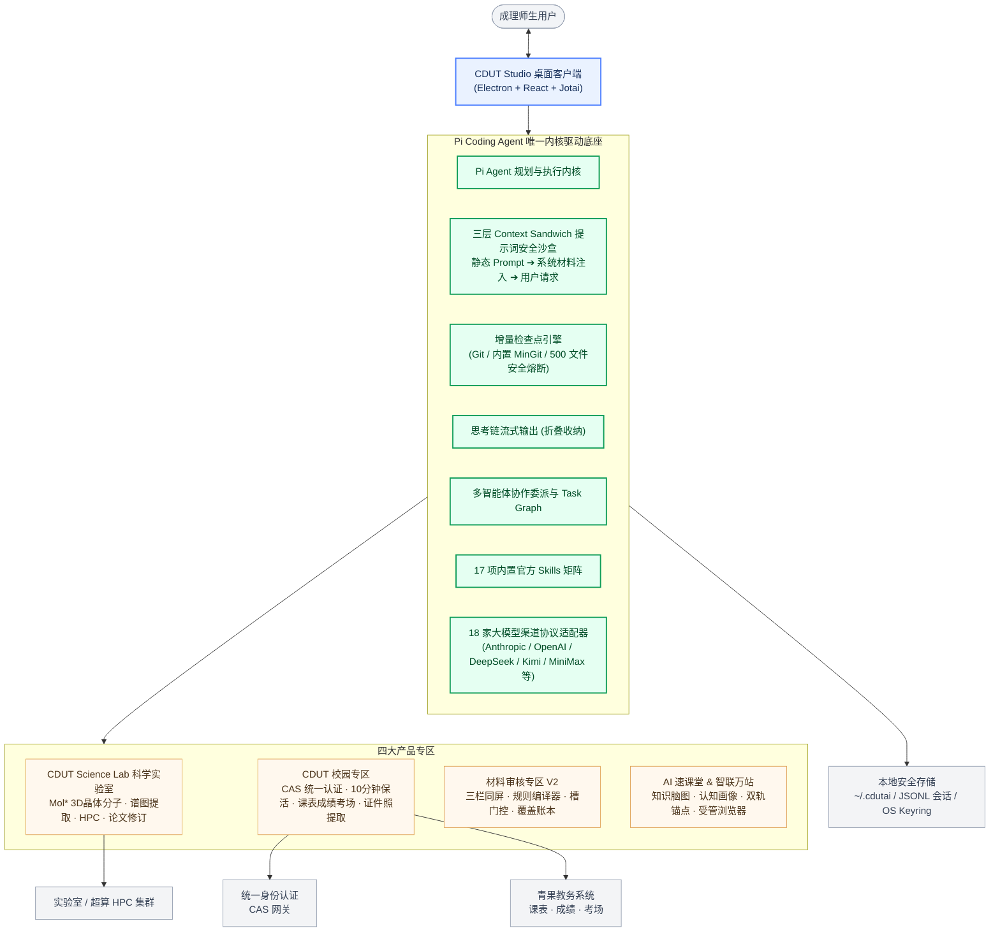

<p align="center">
  
</p>

<a id="cdut-studio-"></a>
<a id="top"></a>
# CDUT Studio 🦖
### 成都理工大学定制 AI 智能体工作台

<p align="center">
  <strong>“穷究于理，成就于工”</strong><br>
  专为成理师生打造的下一代端侧智能体协同平台：前沿科学计算 · 智能教务特区 · 工业级材料审核 · AI 速课堂 · 100% 本地优先
</p>

<p align="center">
  <a href="#-四大产品专区"></a>
  <a href="#multihop-rag-benchmark"></a>
  <a href="#-全景架构与技术栈"></a>
  <a href="#security-and-privacy"></a>
  <a href="LICENSE"></a>
</p>

<p align="center">
  <a href="#-四大产品专区">🌟 四大产品专区</a> •
  <a href="#-cdut-science-lab-科学实验室">🔬 CDUT Science</a> •
  <a href="#-cdut-校园专区与教务特区">🏛️ 校园教务特区</a> •
  <a href="#-材料审核专区-v2-工业级审校工作台">📑 材料审核 V2</a> •
  <a href="#multihop-rag-benchmark">🏆 MultiHop-RAG 评测</a> •
  <a href="#security-and-privacy">🛡️ 网络安全防御</a> •
  <a href="#-全景架构与技术栈">🏗️ 架构与技术栈</a> •
  <a href="#-快速上手">⚡ 快速上手</a> •
  <a href="#-遇见砚小龙">🦖 遇见砚小龙</a> •
  <a href="#-开发团队">👥 开发团队</a>
</p>

---

## 📖 项目简介

> **CDUT Studio** 是一款深度适配**成都理工大学**学术科研与校园生活生态的全功能端侧 AI 智能体（Agent）客户端。

系统以 **Pi Coding Agent 为唯一执行内核**，彻底践行**100% 本地优先（Local-First）**架构。无论是优势学科的跨学科科学前沿计算、期末突击精准提分带教、教务流程自动化秒办，还是复杂的奖助学金与公文材料多栏比对审核，CDUT Studio 都能化身为成理师生的“端侧赛博外脑”，用前沿智能体自动化流打破重复劳动，重构高校学习与科研范式。

---

## 🌟 四大产品专区

<div align="center">
  <table>
    <tr>
      <td width="50%" valign="top">
        <h3>🔬 CDUT Science（科学实验室）</h3>
        <p><b>跨学科科学前沿工作台</b>：内嵌 Mol* 3D 晶体/分子渲染引擎、实验图谱数字化仪（Plot Digitizer）、Origin 交互画板、HPC 集群计算调度、学术论文审阅修订（Track Changes）与 Zotero 文献库联动。</p>
      </td>
      <td width="50%" valign="top">
        <h3>🏛️ CDUT 校园专区（教务特区）</h3>
        <p><b>成理数字校园原生互通</b>：CAS 统一认证静默握手、10 分钟自动保活、青果教务高可用快查（课表/成绩/考场/空教室）、学生证件照三阶梯提取引擎与砚湖易办业务流自动化。</p>
      </td>
    </tr>
    <tr>
      <td width="50%" valign="top">
        <h3>📑 AI 材料审核专区</h3>
        <p><b>三栏同屏审校工作台</b>：标准规范依据 × 送审材料 × AI 研判报告；内置负责人规则文本编译器、必需材料槽门控（<code>minCount</code>）、版本链（<code>supersede</code>）与 11 节点覆盖账本。</p>
      </td>
      <td width="50%" valign="top">
        <h3>🎯 AI 速课堂 & 智联万站</h3>
        <p><b>全景认知带教与受管浏览器</b>：考纲与课件脑图解构、<code>[完全掌握/模糊理解/完全盲区]</code> 三态动态画像、双轨证据定位锚点；内置多标签受管自动化浏览器，安全畅联校内外生态。</p>
      </td>
    </tr>
  </table>
</div>


---

## 🔬 CDUT Science (科学实验室)

围绕成都理工大学在地质古生物、资源勘查、核技术与自动化、材料化工与新能源等优势优势学科的学术需求，CDUT Studio 全新上线了 **CDUT Science** 科学计算工作台，提供系统化六维科研计算能力：

```
                    ┌── 3D 晶体/分子结构交互渲染 (Mol* / CIF / PDB / VASP)
                    ├── 光谱与实验曲线数字化提取 (Plot Digitizer / Origin 画板)
CDUT Science Lab ───┼── HPC 高性能计算集群调度 (Slurm / 作业状态 / 本地库)
                    ├── 学术论文写作修订与边注 (LaTeX / Track Changes / Marginalia)
                    ├── Zotero 本地文献大脑联动 (BibTeX / 知识库索引)
                    └── 科学实验与分析工作流 DAG (可视化节点依赖 / 全生命周期)
```

### 1. 3D 晶体与分子结构可视化 (Mol* 核心)
- **多格式原生解析**：深度集成工业级 Mol* 渲染管线，原生支持 `.cif`（晶胞矢量、空间群对称操作）、`.pdb`、VASP `CHGCAR` / `LOCPOT` 电子密度与静电势 3D 等值面切片渲染。
- **预置科研资产**：开箱内置石榴石（YAG）、钙钛矿（SrTiO3）、金纳米颗粒（fcc）、金红石（TiO2）等典型晶体结构与差分电荷密度模型。

### 2. 光谱与实验曲线数字化提取 (Plot Digitizer & Origin 画板)
- **图纸图像数据提取**：支持将文献扫描件与实验仪器图像直接载入 Plot Digitizer 面板，交互式设定原点与坐标轴，特征峰与离散点秒级提取并导出标准 CSV。
- **Origin 风格交互图版**：光谱数据（XRD / Raman 等）交互式分段缩放、寻峰标记与基线扣除，配合多轨道谱图带（Spectrum Strip）同屏比对。

### 3. HPC 高性能计算调度
- **集群状态与作业提交**：可视化连接管理实验室本地或超算中心 HPC 集群，内置计算作业参数模板生成（Slurm / PBS）。
- **进程追踪与数据持久化**：实时回传作业队列排队与运行日志，计算结果安全拉取并由专属 CSLab 数据库进行持久化记录。

### 4. 学术论文写作、修订与审校流水线 (Manuscript & Track Changes)
- **学术级富文本编辑器**：支持标准 Markdown 与 LaTeX 数学公式渲染（KaTeX），集成科学符号快捷面板。
- **协同修订与批注边注**：原生提供类似 Word / Overleaf 的修订痕迹模式（Track Changes：插入高亮、删除划线、署名标签）以及侧栏交互边注（Marginalia），支持审稿意见一键采纳或驳回。

### 5. Zotero 本地文献大脑联动
- **本地知识库直读**：零上传直连本地 Zotero 数据库，文献条目、PDF 附件与笔记秒级检索。
- **上下文精准投喂**：支持将目标文献元数据与引用内容作为上下文精准挂载进 Agent 对话，论文写作时自动补全规范 Citation。

### 6. 科学实验与分析工作流 DAG
- **可视化节点流编排**：支持将材料准备、建模计算、数据拟合与论文出图编排为拓扑 DAG 工作流。
- **断点重跑与状态审计**：实时监控各计算节点执行耗时、依赖校验与产物落盘，确保科研流程可溯源、可复现。

---

## 🏛️ CDUT 校园专区与教务特区

针对成理校园生态深度定制，在安全合规边界内全面消除重复查课表、登录断线与业务申报烦恼：

```
[用户卡片登录] ➔ [CAS 隐藏窗口静默握手] ➔ [教务主框架 xsMainV 结算] ➔ [10 分钟保活心跳]
       │
       ├── 📅 今日课表 (北京时间教学周自适应)
       ├── 📊 绩点成绩 (五级制/两级制精准换算，历史最新轨)
       ├── 🏫 空教室检索与期末考场速查
       └── 🖼️ 学生证件照三阶梯提取引擎 (Canvas直取 > 窗口Blob规整 > 魔数嗅探)
```

### 1. 特区账户一键接入
- **原生卡片式免跳转登录**：输入学工号与密码，主进程在隔离分区（`persist:cdut-auth-zone`）内通过隐藏窗口完成 CAS 统一身份认证，鉴权落点严格以教务主框架 `/jsxsd/framework/xsMainV` 为准，界面零白屏、零外部跳转。
- **身份画像自动生成**：自动抓取姓名、学工号、学院、专业及真实证件照，生成专属身份卡片。
- **本地加密与静默保活**：凭据由操作系统 `safeStorage`（优先）或 AES-256-GCM 加密落盘 `~/.cdutai/cdut-account.json`；后台每 10 分钟以独立心跳探活，过期如实提示，绝不伪造成功状态。

### 2. 高可用教务接口群 (确保 HTTP 200)
- **瑞数 WAF 动态规避机制**：教务系统部署有瑞数安全网关。底层网络栈在每次请求前**自动剥离陈旧动态 `*P` 签名 Cookie**，确保教务数据接口与图片请求稳定放行，彻底消除 `HTTP 400 Bad Request` 空白响应。
- **学生证件照三阶梯提取引擎**：
  - **阶梯 1（Canvas 直取，零网络延迟）**：学籍页面加载完成后，直接从 Chromium 渲染内存利用 `<canvas>` 导出 Base64 DataURL，彻底免疫 Cookie 失效与防盗链拦截；
  - **阶梯 2（窗口上下文 Blob 规整）**：针对教务二进制流将 `application/octet-stream` 自动规范化规整为标准图片格式；
  - **阶梯 3（主进程魔数嗅探兜底）**：二进制流经 JPEG (`FF D8 FF`) / PNG (`89 50 4E 47`) 文件头特征码严格校验后转 DataURL。
- **课表与成绩全景雷达**：周次自动对齐北京时间，成绩覆盖五级制/两级制中文评级，同分自动继承最新学期。

### 3. 砚湖易办轻量自动化
- **结构化请假与流程申办**：将复杂的多级表单简化为自然语言对话，Agent 智能生成申报理由并流转。
- **责任开源底线**：严禁适配或开放任何教师端特权操作，严格运行在受限学生上下文中。

---

## 📑 材料审核专区

专为班级评优、奖助学金材料申报、社团报销等复杂公文审校场景打造，全面进入 V2 工业级架构：

| 📌 左栏：审核标准依据库 | 📄 中栏：送审材料与材料槽 | ✅ 右栏：AI 研判与覆盖账本 |
| :--- | :--- | :--- |
| • 成理公开评奖细则与公文规范<br>• 自然语言规则文本编译器<br>• 结构化规则解析与版本追溯 | • 必需材料槽门控（`minCount`）<br>• 槽位同名文件版本链（`supersede`）<br>• PDF / Word / Excel 多格式提取 | • 11 节点确定性与 Pi 网关协同执行<br>• 覆盖账本（Coverage Ledger）展开<br>• 驳回/补件/申诉复核（Upheld）闭环 |

- **负责人规则文本编译器 (`compileOwnerRules`)**：支持负责人直接粘贴通知公文，系统逐行提取条款、严重度括号与条目编号，一键编译为结构化 RuleSpec。
- **材料槽门控与覆盖账本**：对必须提交的材料槽位（如“四六级成绩单”、“获奖证书”）进行严格数量校验，检查结果按分组规则逐项展开覆盖账本，无规则或未执行处如实标注。
- **申诉复核争议解决**：支持完整的「初审驳回 ➔ 补件回复 ➔ 再次复核 ➔ 维持原判/更正定稿」合规流转闭环。

---

## 🎯 AI 速课堂与智联万站

### 1. AI 速课堂：期末极速提分带教
- **知识图谱与脑图生成**：拖入 PPT、课件、教材 PDF 与考纲，Agent 自动梳理核心脉络并渲染为交互思维导图。
- **动态认知画像**：将考点精准归类为 `[完全掌握]`、`[模糊理解]`、`[完全盲区]`，针对薄弱点实施苏格拉底启发式推题。
- **双轨定位锚点与零盲搜**：资料直通隔离的 Study Materials Store，大纲直出绝对路径；引用回答直接生成双轨交互胶囊，点击即可在预览面板精准定位到具体文档页码、表格单元格或图表块。

### 2. 智联万站：受管自动化浏览器
- **多标签安全隔离**：内置现代化浏览器标签页体系，支持校内外任意安全站点的流畅浏览。
- **AI 自动化与校内直通**：预置成理教务处、图书馆、砚湖易办、易班等校内书签，支持 AI 视窗截图与自动化表单辅助。

---

<a id="multihop-rag-benchmark"></a>

## 🏆 MultiHop-RAG 权威基准评测

CDUT Studio 校园知识库（RAG）不仅服务于校园问答，更以严谨学术标准开展了全面基准评测。基于官方全集 **MultiHop-RAG（2556 题，含推断/对比/时序/空查询四大题型）**，评测结果如下：

| 检索引擎 | 参评题数 | Hit@4 | Hit@10 | Recall@4 | Recall@10 | MRR | MAP@10 | Null 拒答率 | 平均耗时 |
| :--- | :---: | :---: | :---: | :---: | :---: | :---: | :---: | :---: | :---: |
| **Classic (默认主引擎)** | 2255 | **92.95%** | **98.85%** | **62.91%** | **81.81%** | **0.7942** | **0.5867** | 70.76% | 1.1s |
| **GraphRAG** | 2255 | 87.58% | 96.14% | 52.86% | 73.18% | 0.7103 | 0.4843 | **85.05%** | 1.1s |

> **核心可信性审计**：
> 1. **100% 金标回溯率**：全量 6084 条金标证据条目 100% 成功回溯至语料库，存在证据解析缺失的查询数为 0，杜绝了靠缩小金标集合刷高 Hit/MRR 的行为；
> 2. **自校准 Null 拒答评估**：对答案不在语料中的空查询（Null Query），通过 top-1 分值中位数自校准实现高置信拒答，避免大模型幻觉编造；
> 3. 详细评测指标定义、分题型雷达及数据审计详见完整报告：👉 [MultiHop-RAG 评测完整技术报告](assets/MultiHop-RAG-Scores/multihop-rag-report.md)。

---

<a id="security-and-privacy"></a>

## 🛡️ 全球特大网络安全事件防御与本地信任链

针对爆发于 2026 年 10 月 20 日的「全球特大网络安全事件」（涵盖 eMudhra CA 密钥泄露事故与多语言运行时高危漏洞潮），CDUT Studio 完成了全代码基线的自查与加固，构建起牢固的五重防御防线：

<div align="center">
  <table>
    <tr>
      <td width="20%" align="center">🔒<br><b>底层信任链加固</b></td>
      <td>会话网络栈深度集成证书黑名单，TLS 握手层硬编码阻断泄露 CA 链与中间人流量劫持。</td>
    </tr>
    <tr>
      <td width="20%" align="center">🌐<br><b>内置浏览器插页防护</b></td>
      <td>内置浏览器接入高危证书告警与交互式安全插页，杜绝恶意伪造站点的静默渲染与欺诈。</td>
    </tr>
    <tr>
      <td width="20%" align="center">🛡️<br><b>网络边界抗截断治理</b></td>
      <td>全链路装配 C0 控制字符与 NUL 字节净化防线，彻底根除 CVE-2026-105482 域名混淆利用。</td>
    </tr>
    <tr>
      <td width="20%" align="center">⚡<br><b>执行边界与 MotW 防护</b></td>
      <td>重构工作区文件唤起通道与二次确认机制，全面封堵 CVE-2026-96951 相关的 MotW 绕过利用链。</td>
    </tr>
    <tr>
      <td width="20%" align="center">🧪<br><b>跨运行时零攻击面</b></td>
      <td>基线审计确认产品无 PHP、Go、SPIP 及 .NET 依赖，架构级天然免疫跨语言运行时漏洞。</td>
    </tr>
  </table>
</div>

### 100% 本地优先与数据私有承诺
- **凭据硬件级保护**：教务网与大模型 API 密钥经操作系统 `safeStorage`（DPAPI / Keychain）加密存放在本地用户目录（`~/.cdutai/`），绝不上报任何外部服务器。
- **本地沙盒隔离**：无工作区会话落入独立沙箱；增量检查点引擎严格对主目录与盘符根目录**绝对拒止快照**，物理复制带 500 文件安全熔断。
- **零本地数据库**：绝不引入复杂重型数据库，纯净文本配置与原子化写入保证系统极简透明、零数据锁定。

---

## 🏗️ 全景架构与技术栈

### 全景工作台架构



### 现代工程化技术选型

| 层级 | 技术选型 | 说明 |
| :--- | :--- | :--- |
| **运行时** | **Bun** 1.2.5+ (推荐 1.4.2+) | 统一使用现代化高效 JS/TS 运行时替代 Node.js/pnpm |
| **桌面框架** | **Electron** 43.2.0 | 主进程/Preload 由 esbuild 极速构建，渲染端由 Vite 驱动 |
| **前端体系** | **React** 18 + **Tailwind CSS** + **Radix UI** | 现代化函数式组件，精致卡片与立体阴影取代冷硬边框 |
| **状态管理** | **Jotai** 2.17.1 | 全局与局部状态原子化管理，杜绝状态穿透与不必要重渲染 |
| **执行内核** | **Pi Coding Agent** (`@earendil-works/pi-*`) | **唯一执行内核**，任务规划、多 Agent 协作、工具链调度 |
| **科学计算** | **Mol*** + TipTap + KaTeX | 工业级 3D 分子晶体渲染管线与学术论文富文本编辑 |
| **工程架构** | **Bun Workspace Monorepo** | 包含 6 个核心包（`shared`, `agent-fabric`, `project-core`, `session-core`, `core`, `ui`）以及 Electron 与 CLI 应用 |
| **分发打包** | **Electron Builder** 25.1.8 | 支持 Windows NSIS/便携免安装版与 macOS 打包 |

---

## ⚡ 快速上手

### 📋 环境要求
* **Bun** >= 1.2.5 (推荐 1.4.2+)
* **Git** (可选，Windows 客户端已内置开箱即用的 MinGit 快照引擎)

### 🚀 安装与启动

1. **克隆仓库至本地**
   ```bash
   git clone https://github.com/Nya-Angle/CDUT-Studio.git
   cd CDUT-Studio
   ```

2. **安装 Monorepo 核心依赖**
   ```bash
   bun install
   ```

3. **配置模型渠道**
   启动应用后，在「设置 → 渠道配置」中添加偏好的模型提供商（支持 DeepSeek / 智谱 / MiniMax / Kimi / 豆包 / 通义千问 / Anthropic / OpenAI / Ollama 等 18 家渠道与自定义端点）。所有 API 密钥均在本地硬件级加密存储。

4. **启动开发环境**
   
   ```bash
   bun run dev
   ```
   
5. **工程规范校验**
   ```bash
   bun run typecheck
   ```

---

## 🦖 遇见“砚小龙”

<div align="center">
  <table>
    <tr>
      <td width="30%" align="center">
        <br>
        <b>嗷呜！我是 CDUT Studio 的「砚小龙」~</b>
      </td>
      <td width="70%" align="left">
        <h3>💚 诞生于成理恐龙博物馆与砚湖湖畔的 AI 守护神</h3>
        <p>成理不仅有享誉世界的<b>马门溪龙</b>，更有守护每个深夜赶 DDL 与学术攻关的“砚小龙”！</p>
        <ul>
          <li>🌱 <b>恐龙睡袍与小角</b>：象征成理地学与地质古生物的深厚积淀；</li>
          <li>🎀 <b>砚湖绿缎带</b>：取自砚湖春水色，陪伴你在知识与科学的湖泊中乘风破浪；</li>
          <li>🕰️ <b>北京时间拟物时钟与活跃热力图</b>：桌面端贴心挂载 Analog Clock 与 Usage Heatmap，直观记录你的学术成长轨迹；</li>
        </ul>
      </td>
    </tr>
  </table>
</div>


<details>
<summary><b>🔍 查看「砚小龙」三视图设计资产</b></summary>
<div align="center">
  <br>
  
  
  
  <p><i>CDUT Studio 吉祥物标准三视图 —— 可适配 3D 界面与虚拟形象小组件</i></p>
</div>
</details>

---

## 👥 开发团队

<div align="center">

> 🦖 **CDUT Studio Core Team** · 攀登科学高峰，成就工匠精神

</div>

<div align="center">
<table>
  <tr>
    <td width="50%" valign="top">
      <div style="display: flex; gap: 12px; align-items: flex-start;">
        
        <div>
          <b>队长</b><br/>
          <sub>成都理工大学学生 &nbsp;·&nbsp; 队长</sub><br/>
          <sub><b>负责方向：</b>CDUT Science Lab 架构设计、智联万站与 AI 速课堂研发、RAG 检索增强算法、特区账户技术接入、「砚小龙」IP 形象设计</sub>
        </div>
      </div>
    </td>
    <td width="50%" valign="top">
      <div style="display: flex; gap: 12px; align-items: flex-start;">
        
        <div>
          <b>核心成员</b><br/>
          <sub>成都理工大学学生 &nbsp;·&nbsp; 核心队员</sub><br/>
          <sub><b>负责方向：</b>材料审核专区 V2 研发、项目图像视觉资源设计、客户端 UI 与卡片式交互体验</sub>
        </div>
      </div>
    </td>
  </tr>
  <tr>
    <td colspan="2" valign="top">
      <div style="display: flex; gap: 14px; align-items: flex-start;">
        
        <div>
          <b style="font-size: 16px;">特别鸣谢成员</b> &nbsp; <a href="https://github.com/Yuan-lai-ru-ci/ProferAI" target="_blank"></a><br/>
          <sub><b>特别鸣谢 & 核心成员</b></sub><br/>
          <sub><b>突出贡献：</b>衷心感谢该成员为本项目提供优秀的基座支持，并在客户端底层通信与架构选型中提供坚实的技术支撑！推荐关注其开源 Agent 项目 👉 <a href="https://github.com/Yuan-lai-ru-ci/ProferAI" target="_blank"><b>ProferAI</b></a>。</sub>
        </div>
      </div>
    </td>
  </tr>
  <tr>
    <td width="50%" valign="top">
      <div style="display: flex; gap: 12px; align-items: flex-start;">
        
        <div>
          <b>核心成员</b><br/>
          <sub>成都理工大学学生 &nbsp;·&nbsp; 核心队员</sub><br/>
          <sub><b>负责方向：</b>核心交互功能设计、RAG 知识库工程构建、全流程技术架构与部署文档撰写</sub>
        </div>
      </div>
    </td>
    <td width="50%" valign="top">
      <div style="display: flex; gap: 12px; align-items: flex-start;">
        
        <div>
          <b>核心成员</b><br/>
          <sub>成都理工大学学生 &nbsp;·&nbsp; 核心队员</sub><br/>
          <sub><b>负责方向：</b>砚湖易办业务流逻辑梳理、学业场景需求设计、系统功能手册与用户操作指南设计</sub>
        </div>
      </div>
    </td>
  </tr>
</table>
</div>

---

## 📜 许可证与免责声明

本项目基于 **GNU Affero General Public License v3.0 (AGPL-3.0)** 开放源代码。详见 [LICENSE](LICENSE) 文件。

*免责声明：CDUT Studio 为成理学生自主开源 AI 智能体项目，非官方商业软件，旨在促进开源技术交流、学术科研效率与校园数字化学习体验提升。*

<br/>

<div align="center">
  <p><b>穷究于理，成就于工 · 攀登科学高峰，从 CDUT Studio 开始。</b></p>
  
  <br/><br/>
  <sub>CDUT Studio is an independent open-source project by <b>@雫窝中央实验室</b>. © 2026.</sub>
  <br/><br/>
  <a href="#cdut-studio-">⬆ 返回顶部</a>
</div>
