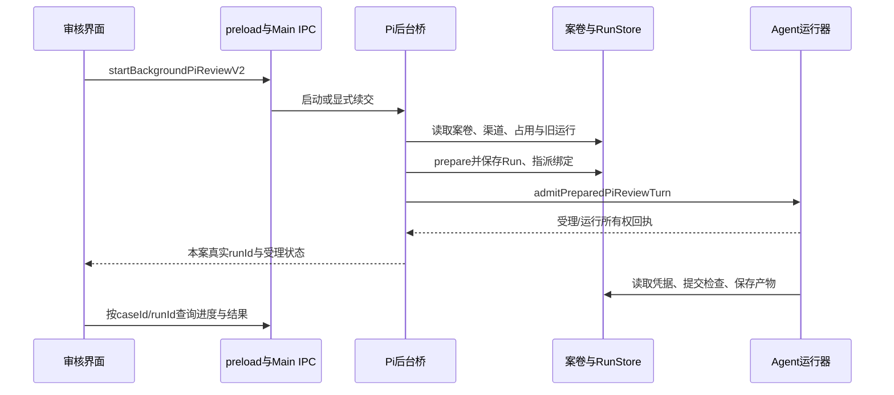

# 材料审核业务流程与状态转换

基线：`05fb2565e20eb1760233696be1832f68196b37c2`。前置为已独立通过的 [CODEBASE-MAP](CODEBASE-MAP.md) 与 [模块／API 参考](API-REFERENCE.md)。本文把真实入口、主账、运行和决定连接起来；所有行为结论为静态源码核对，真实模型、Electron GUI、外部交付和故障场景 **NOT_RUN**。

## 1. 一次审核涉及哪些对象

| 对象 | 标识与用途 | 不代表什么 |
|---|---|---|
| 案卷 | caseId、templateId/version、caseFields、subjects、documents、stage、revision | 新建案卷不等于已提交审核 |
| 材料版本 | documentId/versionId、contentHash、parseRevision、blocks、角色／材料槽 | 文件同名不等于同一版本；解析成功不等于本轮已经阅读 |
| 规则／计划 | 模板规则、政策引用、案卷规则或固定的技术计划 | 本地 candidate／技术计划不等于校方发布授权 |
| 运行 | runId、inputManifest、checks、coverage、diagnostics、status | 技术运行结束不等于业务批准 |
| 事实与证据 | Observation、EvidenceLink、SourceRef | 模型提取不等于人工已确认；引用成立不等于政策真实性已认证 |
| 业务决定 | actor、理由、依据 Run／revision、task、结果及 finality | 一条 AI opinion 不会自行成为 BusinessDecision |

源契约：[review-v2.ts:318–381、473–536](../../baseline/source/packages/shared/src/types/review-v2.ts)、[application-service.ts:146](../../baseline/source/apps/electron/src/main/lib/review/application-service.ts)。

## 2. 产品入口与材料登记

主界面经 CDUT 专区进入 `ContentReviewView`。材料导入后，`quickStart` 将目标 caseId 带到普通 `case-task` 页面；高级工作台和 V2 办理页仍存在，不能把所有页面视为同一条执行入口。证据：[ContentReviewView.tsx:69–126](../../baseline/source/apps/electron/src/renderer/components/content-review/ContentReviewView.tsx)、[ReviewV3CaseTaskView.tsx:45–108](../../baseline/source/apps/electron/src/renderer/components/content-review/ReviewV3CaseTaskView.tsx)。

材料通过 Main 的文件选择／拖拽路径登记。兼容导入链是 `importDocumentsIntoCase → importDocumentFromPath → parseFileIntoSourceDocument → case 保存／V2 投影`；原生材料注册入口还执行 C0 Main sender 和提交时授权检查。它们不是可互相套用权限描述的同一个 handler。可复用服务不等于每条入口都具有同样守卫。证据：[case-import.ts:130–203](../../baseline/source/apps/electron/src/main/lib/review/case-import.ts)、[review-ipc.ts:403–452](../../baseline/source/apps/electron/src/main/lib/review/review-ipc.ts)。

登记需要保留原件、角色、版本与解析结果。批量选择中某个文件失败可进入 `failures`，其余继续处理；取消选择返回 canceled，不表示已经登记成功。解析链区分文本／表格／Office／PDF／图片；不支持或解析失败应保留失败原因与原件核验入口，而不是制造可读内容。PDF 图像保留有上限，截断与渲染失败要进入警告。证据：[case-import.ts:32–121、174–200](../../baseline/source/apps/electron/src/main/lib/review/case-import.ts)、[document-service.ts:1–44、90–150](../../baseline/source/apps/electron/src/main/lib/review/document-service.ts)。

## 3. 选择规则与方案：正式建案和技术预审分开

正式 `createCaseFromTemplate` 仅接受 published 模板，校验政策引用、字段作用域、事项与材料要求，建立 revision=0 的 draft，并保存创建 receipt。允许不完整入库的分支只表示可以先建“待补”草稿，不绕过提交前的检查。证据：[application-service.ts:146–216](../../baseline/source/apps/electron/src/main/lib/review/application-service.ts)。

普通案卷页可列出 D4 方案并调用 `attachD4TechnicalPlanV3`；作者也可保存、预览和冻结 B1 candidate。技术预审使用固定的 D2/D4/B1 责任及来源，不通过“本机已经选择方案”推导校方制度认证。正式模板发布、作者 candidate freeze、向案卷安装技术计划是不同操作。证据：[ReviewV3CaseTaskView.tsx:73–108](../../baseline/source/apps/electron/src/renderer/components/content-review/ReviewV3CaseTaskView.tsx)、[review-v3-main-local-author-workbench.ts:45–89](../../baseline/source/apps/electron/src/main/lib/review/review-v3-main-local-author-workbench.ts)、[review-d2-runtime.ts](../../baseline/source/apps/electron/src/main/lib/review/review-d2-runtime.ts)。

## 4. 正式提交和本地预审有不同起跑条件

`submitCaseV2` 验证 draft／可恢复的 submitted 状态、材料非空、模板存在、必填字段、事项要求、材料槽最小数量以及首阶段。提交状态与首任务在同一个聚合事务保存；已成功提交的重试可以返回原 receipt，而不是重复生成任务。证据：[stage-workflow.ts:359–399](../../baseline/source/apps/electron/src/main/lib/review/stage-workflow.ts)。

**界面上的本地预审不必等同于正式提交成功。** `ReviewV3UnifiedRun.start` 对非技术计划草稿尝试提交，失败会明确显示“仍为草稿，本地预审继续”；随后分别尝试模板规则和后台 Pi，分别保留错误／回执。不能把该 UI 操作描述为一个全有或全无的业务事务。证据：[ReviewV3UnifiedRun.tsx:65–115](../../baseline/source/apps/electron/src/renderer/components/content-review/ReviewV3UnifiedRun.tsx)。

旧图执行服务 `assertCaseReadyForReview` 会拒绝 draft、archived 或缺必填输入；Pi 准备服务则检查 archived、计划、规则、目标及运行占用，没有同样的 draft 拒绝。因此高级／批量／Pi 入口应按各自契约阅读，不能把某一路的起跑条件推广到所有路径。证据：[run-async-service.ts:82–105](../../baseline/source/apps/electron/src/main/lib/review/run-async-service.ts)、[pi-case-review-service.ts:452–486](../../baseline/source/apps/electron/src/main/lib/review/pi-case-review-service.ts)。

## 5. 受理后台审核并冻结本轮输入

桥接服务检查输入类型、窗口存活、同案短临界区、渠道／模型可用性和已有运行，并按 mode 决定复用或新建 review-owned Pi 会话。它不会把普通聊天工作区默认当作审核沙箱。准备服务创建 assignment、Run 并绑定两者；受理失败需要记录失败和撤销指派，不能仅在 UI 显示“已经开始”。证据：[review-pi-run-bridge.ts:24–105](../../baseline/source/apps/electron/src/main/lib/review/review-pi-run-bridge.ts)、[pi-case-review-service.ts:452–529](../../baseline/source/apps/electron/src/main/lib/review/pi-case-review-service.ts)。

`inputManifest` 保存材料版本／内容哈希、模板版本、事实／证据标识及有效规则信息。普通 Pi `buildRun` 没有设置 `planFingerprint`；不能把 input hash 当作完整冻结计划指纹，也不能宣称所有执行器已经共享同一个物理 Run。模板规则仍写独立 `run-tpl-*` 记录，其当前身份被分类为 diagnostic／阶段证据。证据：[pi-case-review-service.ts:274–309](../../baseline/source/apps/electron/src/main/lib/review/pi-case-review-service.ts)、[review-runtime-contract.ts:20–88](../../baseline/source/apps/electron/src/main/lib/review/review-runtime-contract.ts)。

## 6. 阅读材料、提交检查和计算覆盖

本轮材料能力从绑定案卷建立。读取块／预览原件会形成可追溯凭据；提交材料引用时，服务校验当前 active 文件版本、blockId 和 quote，并从当前 document 重建 parseRevision／location；不是校验调用方传入的 parseRevision。文件名、模型编造的路径或一句“已阅读”不能代替该绑定。证据：[pi-case-review-service.ts:312–336、634–677、915–938](../../baseline/source/apps/electron/src/main/lib/review/pi-case-review-service.ts)。

覆盖是两组账本：**材料读到什么程度**与**计划检查完成到什么程度**。全部解析块读完只有在相应解析／图片完整性条件满足时才能算全文已读；解析失败占位块不算原件已读，普通预览／少量引用也可能只是 partially-read。证据：[pi-document-coverage.ts:25–96](../../baseline/source/apps/electron/src/main/lib/review/pi-document-coverage.ts)。

提交服务核验 assignment、running、未归档、模板／D2 计划和输入哈希。`finish:true` 时缺检查或存在拒绝结果，会保存拒绝／缺项记录并返回 running，允许继续补交。正常完成会保存检查、摘要、读取覆盖和 business-readiness 产物；终端流结束但没有明确完成提交，则保存部分完成。证据：[pi-case-review-service.ts:915–938、1039–1163](../../baseline/source/apps/electron/src/main/lib/review/pi-case-review-service.ts)。

必须同时展示三个不同层次：

- `run.status=completed`：技术轮已结束。
- `businessReady`：Run 状态为 completed，且没有待确认／补件、执行失败、未执行检查并且材料全读；不要求所有检查都判为 compliant。
- `BusinessDecision`：有权限的业务办理命令形成的决定，不能从前两项自动推导。

判定函数见 [pi-case-review-service.ts:819–836](../../baseline/source/apps/electron/src/main/lib/review/pi-case-review-service.ts)。

## 7. 选“当前运行”并办理人工确认

历史 Run 可以保留展示，但不应随意替代当前审核。`resolveCurrentBusinessRun` 排除 diagnostic 和合成 ID，取最新业务 attempt；最新仍运行、失败或取消就阻断，不回退旧成功。旧 V2 `run-*` 也可能属于业务 attempt，不能只按“是不是 Pi”筛选。满足 completed／partial 还必须通过当前输入与 T03 核验。证据：[review-runtime-contract.ts:32–49、134–194](../../baseline/source/apps/electron/src/main/lib/review/review-runtime-contract.ts)。

workspace 的处置、事项最终认定、决定等命令还核对原件有效性、输入哈希、补件发生时间及所指 Run 是否就是当前权威 Run。当前 T05／原生办理入口的 stage-pass 具有额外 T03 门禁；旧模板阶段路径 `recordStageDecision` 本身并没有该 Run／T03 校验，不可混为同一个入口。部分完成不是当前 T05 直接批准资格。事实修正或补件改变输入后，旧 Run 可能仍可查看，但应重新审核后再办理。证据：[workspace-business-service-v2.ts:87–110、274](../../baseline/source/apps/electron/src/main/lib/review/workspace-business-service-v2.ts)、[review-runtime-contract.ts:178–194](../../baseline/source/apps/electron/src/main/lib/review/review-runtime-contract.ts)。

## 8. 业务状态转换与权限

案卷状态、Run 状态和 workflow task 状态是不同状态机，不应合并成一个“完成”字段。

| 业务动作／分支 | 实际效果 | 关键前置 |
|---|---|---|
| 从模板创建 | draft，revision=0 | 已发布模板；字段／主体与依赖合法 |
| 提交 | submitted 并创建首任务 | 必填输入、材料槽、首阶段；同一聚合事务 |
| 阶段通过且有下一阶段 | 创建下一任务，案卷 reviewing | 当前开放任务、模板版本、执行角色／分配对象 |
| 阶段通过且无下一阶段 | decided | 合法阶段动作及理由；不是模型自行决定 |
| 事项通过／部分通过 | 当前任务重新保持开放 | 事项级动作不自动结束整案 |
| 退回补件 | awaiting-supplement，创建明确补件请求 | 所需要素与原因非空 |
| 退回上一阶段 | 新一轮任务，reviewing | 模板声明合法退回目标 |
| 最终驳回 | decided | 明确 final-reject 与理由 |
| 撤回 | archived | 合法业务命令 |

上表描述 `recordStageDecision` 的模板阶段路径，不声称所有分支都由同一个界面按钮触发。workspace 决定、批次评分等另有自己的入口和更具体门禁。阶段路径会检查角色／assigneeActorId，Agent 不得替代 teacher／校方阶段；本地 reviewer 身份也不是学校授权。D2 技术预审显式拒绝正式阶段决定。证据：[stage-workflow.ts:81–195](../../baseline/source/apps/electron/src/main/lib/review/stage-workflow.ts)、[review-c0-authority.ts:21–86](../../baseline/source/apps/electron/src/main/lib/review/review-c0-authority.ts)。

补件回复与“补件已满足”不同。`respondSupplementV2`、`resolveSupplementV2` 分别负责提交者回复和有权限的核验；不能仅凭上传文件就跳过核验。申诉处理也有单独命令。证据：[stage-workflow.ts:198、238、295](../../baseline/source/apps/electron/src/main/lib/review/stage-workflow.ts)。

## 9. 形成报告与交付文件

本地报告服务读取聚合、决定、补件和真实 Run。显式指定时选本案对应 Run；没有显式 Run 时，当前 `latestReportDecision` 实际把 decisions 按时间降序排序后取 `.at(-1)`，因此取到最早一条决定（同时间再按 ID），并未筛选 finality，再用它的 basedOnRunId 选 Run。这与函数名／提示中的“最新／最终决定”不一致，是当前实现缺陷；不能写成已保证选择最新最终决定。该决定引用的 Run 不存在时拒绝替换；没有任何决定时才取最新技术 Run。报告里展示的反馈决定还由反馈投影生成，因此也不能据选 Run 成功推断两者已经一致。导出技术历史不表示为它补做正式决定。

受众也需单独裁定。缺可信 actor 或 agent/mock 请求内部视图会降级学生版；内部意见、人工豁免等按受众投影。报告包含技术状态、覆盖、来源、运行选择理由、归档代次与内容摘要；摘要 hash 是内容指纹，不是行政签名。证据：[review-v3-report-snapshot.ts:26–76、132–165、178–205](../../baseline/source/apps/electron/src/main/lib/review/review-v3-report-snapshot.ts)、[report-export-v2-service.ts:30–145](../../baseline/source/apps/electron/src/main/lib/review/report-export-v2-service.ts)。

实际确认的交付落点是 `<config>/review-cases/<caseId>/reports/report-*.md`，函数返回 file、所选 Run、受众授权与 snapshotDigest。没有 Run 会拒绝导出；未完成内容在报告中明确披露。本地文件写成不等于学校远端收到、签收或认可结论。证据：[report-export-v2-service.ts:145–167](../../baseline/source/apps/electron/src/main/lib/review/report-export-v2-service.ts)。

## 10. 停止、重启、归档与恢复

| 情况 | 当前处理与开发者注意点 |
|---|---|
| 用户停止 Pi | 停止运行并转 cancelled／保留已完成范围；实际中止时延需真实模型验证 |
| 流正常结束但没完成提交 | partially-completed，不制造完整结果 |
| 应用重启遗留 queued/running | failed＋`interrupted: 进程重启` 诊断；即使恢复写失败也保留旧授权拒止 |
| 显式续交 | 符合条件可复用原 RunId／检查点；这是新回合，不重放未知 Provider 请求 |
| 输入或模板改变 | 旧结果进入过期／不可办理分支；不能只凭同一 caseId 继续批准 |
| 案卷软归档 | 拒绝仍有 queued/running；保存归档理由及此前阶段，不删除原件和历史 |
| 从归档恢复 | 显式命令恢复为 draft并递增 revision，旧运行与决定需要重新核验；不是重新批准 |

证据：[pi-case-review-service.ts:1128–1168](../../baseline/source/apps/electron/src/main/lib/review/pi-case-review-service.ts)、[run-store-v2.ts:32–127](../../baseline/source/apps/electron/src/main/lib/review/run-store-v2.ts)、[review-pi-run-bridge.ts:66–96](../../baseline/source/apps/electron/src/main/lib/review/review-pi-run-bridge.ts)、[case-lifecycle-v3.ts:36–110](../../baseline/source/apps/electron/src/main/lib/review/case-lifecycle-v3.ts)。

## 11. 修改影响与实际复验场景

改变模板／材料／事实会影响 inputManifest、规则依赖、读取凭据继承、当前运行解析、T03、业务决定和报告投影；改变 UI 不应绕过 Main 里的这些约束。接口字段和错误返回见 [API-REFERENCE](API-REFERENCE.md)，关键差异由后续 `DESIGN-VS-IMPLEMENTATION.md` 逐项说明。

用户实际测试建议至少覆盖：一份可读材料到报告、解析失败原件核验、缺材料槽的本地预审与正式提交差异、材料替换后旧 Run 失效、最新失败不回退旧成功、停止／冷启动显式续交、补件核验、受众降级、归档恢复后旧报告历史标签。本轮未运行这些场景，不能把上述源码路径描述当作实测通过。
