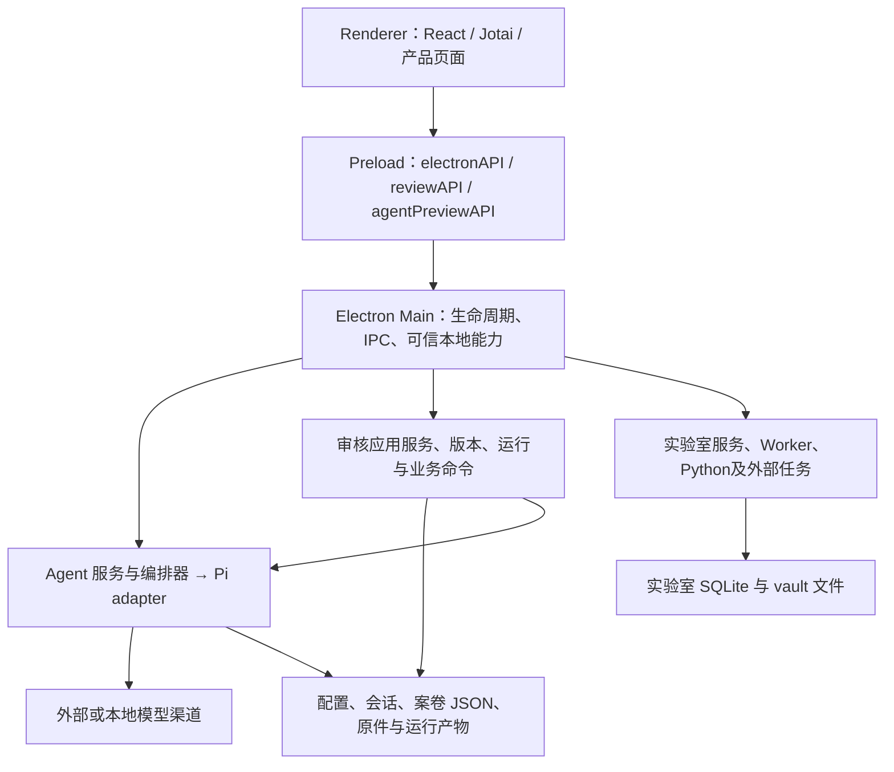

# CDUT Studio 当前架构

源码基线：`05fb2565e20eb1760233696be1832f68196b37c2`。本文依据已通过独立验收的 [源码地图](CODEBASE-MAP.md)、[模块机制与接口参考](API-REFERENCE.md)，以及下列直接源码核对编写。本文描述冻结版本的实际结构；真实 Electron、模型、外部服务和故障恢复运行验证均为 **NOT_RUN**。单文件手册是否已完成独立验收，另见交付状态，不能由本文的存在推定全部通过。

## 1. 系统形态与进程边界

当前系统是 Electron 桌面应用和共享包组成的工作区。主要产品能力包括普通 Agent 会话、校园专区及材料审核、科学实验室、学习及外部集成。审核业务运行在桌面应用的 Main 服务中，没有证据表明它已成为一个独立部署、统一远端数据库支持的审核后端。

箭头表示已核对的调用或装配方向，不表示各服务始终启动，也不表示跨进程的一次 UI 操作具有全链事务。事件回程通过 Main 发送、preload 订阅、renderer listener/atoms 更新；invoke 的返回值与流事件是两条不同的数据回程。具体入口与边见 [源码地图 §§3–7](CODEBASE-MAP.md)。

普通 Agent 服务实际构造 `PiAgentAdapter`；`runAgent` 进入 `AgentOrchestrator.sendMessage`，再调用 adapter。历史 Claude 名称、兼容字段或类型不能证明另一套默认运行器已经启用。可选 Agent Fabric 则是任务传输与调度入口，复用 headless 执行能力，不是模型 provider 的别名。证据：[agent-service.ts:54、277、404](../../baseline/source/apps/electron/src/main/lib/agent-service.ts)、[agent-orchestrator.ts:2554](../../baseline/source/apps/electron/src/main/lib/agent-orchestrator.ts)、[agent-fabric-service.ts:80](../../baseline/source/apps/electron/src/main/lib/agent-fabric/agent-fabric-service.ts)。

## 2. 启动与能力装配

真实应用启动经过 `app.whenReady → bootstrap`。bootstrap 先注册本地协议和证书策略、准备运行环境，随后注入技能 bundle 来源、注册 IPC、安装 C11 本地作者／材料接入／D4／B1 技术计划能力，创建窗口。全局技能迁移、预设准备和旧 seed 在主窗显示后执行，而不是把整个资源扫描过程放在首屏之前。

这些步骤的顺序影响可用性和授权：仅调用 `registerReviewIpc()` 的独立测试不会自然获得真实 bootstrap 安装的本地能力；注册了一个 IPC 也不表示其依赖的权威来源已经安装。证据：[main/index.ts:903、909、925–951、991–1001](../../baseline/source/apps/electron/src/main/index.ts)、[review-ipc.ts:107–110](../../baseline/source/apps/electron/src/main/lib/review/review-ipc.ts)。

开发态从 Vite URL 加载 renderer，打包态加载构建文件。技能也区分打包来源与用户配置下的 seed 副本；修改 bundle 不等于既有用户副本立即改变。主窗口 move/resize 经防抖写回设置；这些平台状态并非 renderer atom 的持久化职责。证据：[main/index.ts:457、604、716、721、757–768、939](../../baseline/source/apps/electron/src/main/index.ts)。

## 3. 模块边界与依赖方向

`p01`–`p08` 是文档责任分区，并非八个独立 npm 服务。审核源目录横跨 p04/p05/p06；renderer 与共享 UI 汇入 p08。修改时先按源码地图找到真正文件，再按接口与调用方判断影响。

| 责任层 | 当前职责 | 详细说明 |
|---|---|---|
| 应用壳与配置 | 窗口、启动、IPC、设置、打包资源及配置根 | [p01](MODULE-REFERENCE/p01-app-shell/OVERVIEW.md) |
| Agent 运行时 | 会话编排、模型适配、工具、权限和技能装配 | [p02](MODULE-REFERENCE/p02-agent-runtime/OVERVIEW.md) |
| 集成与实验室 | 文件、文稿、科研工具、外部系统与相关服务 | [p03](MODULE-REFERENCE/p03-integrations/OVERVIEW.md) |
| 审核案卷核心 | 案卷身份、版本、原件、Main 权威与新契约 | [p04](MODULE-REFERENCE/p04-review-case-core/OVERVIEW.md) |
| 审核执行与业务 | 规则／Pi 运行、事实、覆盖、业务办理与报告 | [p05](MODULE-REFERENCE/p05-review-engine/OVERVIEW.md) |
| 批次与配套流程 | 批量、自动化、评分及相关协调 | [p06](MODULE-REFERENCE/p06-review-batch/OVERVIEW.md) |
| 共享包 | 业务类型、纯规则、文档引擎、会话／项目／Fabric 基础能力 | [p07](MODULE-REFERENCE/p07-shared-libs/OVERVIEW.md) |
| 界面与投影 | 页面、Jotai 状态、交互控制器及共享组件 | [p08](MODULE-REFERENCE/p08-renderer-ui/OVERVIEW.md) |

类型导入不等于运行期跨进程调用。renderer 中从 Main 源文件导入的 `import type` 必须与实际 IPC 调用分开看；API 注册表中的导出、注册和声明数量也不是已接线产品接口数量。

## 4. 数据模型与权威状态

系统没有一个统管全部子系统的存储事务。审核以文件主账为基础，实验室同时使用 SQLite 与文件，普通设置还有独立缓存与写入方式。

| 数据 | 实际权威／落点 | 不应混淆的内容 |
|---|---|---|
| 业务配置根 | Main `resolveConfigDir/getConfigDir`；正式默认 `.cdutai`、开发默认 `.cdutai-dev`，`PROFER_CONFIG_DIR` 可覆盖 | Electron userData 是另一套路径；不能一概写成 `~/.cdutai` |
| 设置 | `settings.json` 与 `settings-service` 缓存 | UI atom 是投影；直接设置写不是审核主账耐久事务 |
| 工作区与会话 | 工作区索引／目录、会话索引／内容，由 Main 管理 | 列表、内存事件、运行中会话与落盘转录不是同一对象 |
| 模板版本 | `review-templates/<templateId>/versions/<version>.json`；另有发布资格控制记录 | `published` 是当前模板服务状态，不等于校方制度已经认证 |
| B1 作者与候选 | `review-v3-author-candidate/<templateId>` 中的作者修订／冻结候选 | 作者修订、candidate Plan、正式案卷 Plan 是不同权威对象 |
| 审核业务聚合 | `review-cases/<caseId>/state.v2.json` | `case.json` 兼容展示、renderer 缓存和 Run 文件不能替代主账 |
| 审核运行 | `runs-v2/<runId>.json`；节点产物在该 Run 的 artifacts 目录 | Run 不存进 CaseAggregate；技术结果不等于 BusinessDecision |
| 科学实验室 | 每 lab 的 `db/central_meta.sqlite` 与文稿／表格／图片／Word 等文件 | DB 事务不能自动回滚先前写完的文件 |

证据：[config-paths.ts:24–80](../../baseline/source/apps/electron/src/main/lib/config-paths.ts)、[template-store.ts:27–65](../../baseline/source/apps/electron/src/main/lib/review/template-store.ts)、[B1 author store:18–60](../../baseline/source/apps/electron/src/main/lib/review/review-template-author-store-v3-b1.ts)、[case-store-v2.ts:31、203](../../baseline/source/apps/electron/src/main/lib/review/case-store-v2.ts)、[run-store-v2.ts:14–30、162](../../baseline/source/apps/electron/src/main/lib/review/run-store-v2.ts)、[cslab-db.ts:122、307](../../baseline/source/apps/electron/src/main/lib/cslab/cslab-db.ts)。

V1 与 V2 沿用相同 caseId 的迁移／兼容路径仍存在。`workspace-service-v2` 把旧表单等来源投影进新聚合，并保留 V2 人工事实、处置和决定；原生路径又有独立写权保护。不能根据文件名中版本数字决定谁覆盖谁。证据：[workspace-service-v2.ts:1、23、154、165](../../baseline/source/apps/electron/src/main/lib/review/workspace-service-v2.ts)、[review-ipc.ts:86](../../baseline/source/apps/electron/src/main/lib/review/review-ipc.ts)。

## 5. 审核运行与业务办理的分离

当前至少需要区分三种运行记录：普通 Pi 后台业务运行 `run-pi-*`，模板规则阶段 `run-tpl-*`，以及旧 V2 图运行等兼容入口。`classifyRunAuthority` 将模板／显式诊断前缀排除为 diagnostic，但其他旧 `run-*` 仍可被视为 business-attempt。因此不能声称“所有当前业务只可能由 Pi 生成”。

当前业务运行解析会选择最新业务 attempt；最新一次仍运行、失败或取消时，不回退旧成功。满足完成／部分完成状态也仍须核对输入与 T03 当前性。报告选 Run 又有独立选择逻辑：显式指定优先，无决定时取最新技术 Run；存在决定时，当前 `latestReportDecision` 采用降序排序后 `.at(-1)`，实际选最早决定且不筛 finality，再按该记录绑定 Run。函数名和提示中的“最新／最终”不能代替真实排序行为，这是需要保留的实现缺陷；导出也不构成对所选 Run 的业务认可。证据：[review-runtime-contract.ts:20–49、134–194](../../baseline/source/apps/electron/src/main/lib/review/review-runtime-contract.ts)、[review-v3-report-snapshot.ts:26–76](../../baseline/source/apps/electron/src/main/lib/review/review-v3-report-snapshot.ts)。

普通 Pi 准备服务建立案卷／会话／指派绑定，材料能力产生真实读取凭据，提交服务重新验证运行状态、输入哈希、模板／D2 计划与来源。`finish` 请求不完整时保持 `running`；正常会话结束但没有完成提交会记为 `partially-completed`。技术 `completed` 之后还单独计算 `businessReady`，而 `businessReady` 也不是“检查全部符合”或“正式批准”：发现不符合仍可以形成完整、可供办理的审核结果。

证据：[pi-case-review-service.ts:452、634、819、915、1039、1128](../../baseline/source/apps/electron/src/main/lib/review/pi-case-review-service.ts)。业务决定通过独立命令和任务／角色／修订号门禁形成，D2 技术预审不能借此变成正式阶段决定：[stage-workflow.ts:81–112](../../baseline/source/apps/electron/src/main/lib/review/stage-workflow.ts)。

## 6. 可信边界与实际限制

1. **进程与发送方。** preload 把允许的方法暴露给 renderer；`reviewAPI` 与 `agentPreviewAPI` 有主帧条件，普通 `electronAPI` 不能一概宣称有同样条件。Main 是否验证 sender 由具体 handler 决定，详见 API 参考。
2. **本地身份与学校授权。** C0 从活跃 Main frame 派生本地 reviewer，不接受 renderer 自称 teacher/system 作为凭据。C11 本地作者能力也不等于学校发布者。正式 Plan 升级依赖独立来源；缺依赖的注册入口应拒绝，而不是从候选 JSON 合成授权。证据：[review-c0-authority.ts:21–86](../../baseline/source/apps/electron/src/main/lib/review/review-c0-authority.ts)、[review-v3-main-author-plan-ipc.ts:64–80、131–176](../../baseline/source/apps/electron/src/main/lib/review/review-v3-main-author-plan-ipc.ts)。
3. **模型输出与业务证据。** 输出的材料引用必须重新落到本案当前文件版本、解析修订与材料块。自然语言总结、提示词和来源格式合法都不能代替真实制度认证或人工业务决定。
4. **工具门禁按实际调用生效。** 普通审核业务工具中的 `requireAssignment` 未普遍传入 `turnId/requireTurnMatch`；普通只读工具也有不携指派浏览摘要的分支。不能仅由 scope／turn 帮助函数存在就声称已实现全接口逐轮隔离。这与案卷绑定 Pi 模式的专用工具集合须分开看。证据：[pi-review-ops-tools.ts:197–205、270–310](../../baseline/source/apps/electron/src/main/lib/adapters/pi-review-ops-tools.ts)、[review-agent-assignment.ts:265–303](../../baseline/source/apps/electron/src/main/lib/review/review-agent-assignment.ts)。
5. **文件保护因子系统而异。** ID 校验、词法路径包含检查、B1 vault 的文件属性／nofollow 校验和导出对话框各有边界，不能宣传成全仓统一的物理路径沙箱。

## 7. 一致性、故障与恢复

审核聚合命令经过逐案队列和 C2 磁盘事务，校验请求幂等、expectedRevision、归档状态后在副本上变更，revision 统一递增，业务变化与 receipt 同次保存。耐久写入使用独占临时文件、文件 fsync、rename；POSIX 另同步父目录，Windows 不承诺相同目录 fsync 语义。发生 rename 后错误时，应重读 receipt 判断是否已经提交，不能盲目生成新 requestId 重做。证据：[case-store-v2.ts:203–259](../../baseline/source/apps/electron/src/main/lib/review/case-store-v2.ts)、[review-v3-case-disk-tx.ts:118–153](../../baseline/source/apps/electron/src/main/lib/review/review-v3-case-disk-tx.ts)。

这不是全仓通用事务承诺：V1 `updateCase` 不传 expectedRevision 时会跳过 CAS；RunStore 使用独立 JSON 写入；settings 直接覆盖；实验室文稿先写 md/sidecar 再提交 DB。修改这些边界必须分别审查，不能把某一层的“原子”推广到整个业务。证据：[case-store.ts:278–300](../../baseline/source/apps/electron/src/main/lib/review/case-store.ts)、[settings-service.ts:93–117](../../baseline/source/apps/electron/src/main/lib/settings-service.ts)、[cslab-manuscript.ts:244–306](../../baseline/source/apps/electron/src/main/lib/cslab/cslab-manuscript.ts)。

启动会把遗留 `queued/running` Run 记为 `failed` 并附 `interrupted` 诊断；`interrupted` 不是 Run 状态枚举。显式续交复用检查点，是新回合，不表示恢复或重放了中断前未知结果的 Provider 请求。OOXML 只有 worker 分支具备 30 秒终止看门狗；缺 bundle 的进程内降级不能继承该承诺。证据：[run-store-v2.ts:32–127](../../baseline/source/apps/electron/src/main/lib/review/run-store-v2.ts)、[review-pi-run-bridge.ts:66–96](../../baseline/source/apps/electron/src/main/lib/review/review-pi-run-bridge.ts)、[cslab-ooxml.ts:1120–1137](../../baseline/source/apps/electron/src/main/lib/cslab/cslab-ooxml.ts)。

## 8. 修改代码时的使用方式

先从 [源码地图](CODEBASE-MAP.md) 定位责任与实际调用边，再查对应模块总览和单文件手册。接口参数、返回值和前置条件以 [API-REFERENCE](API-REFERENCE.md) 的真实调用约束及其源定义为依据。改变材料／模板／事实时检查输入哈希与旧运行失效；改变业务命令时检查 CAS、receipt、权限和恢复；改变资源位置时同时核开发与打包来源。

完整审核过程见 [BUSINESS-FLOW](BUSINESS-FLOW.md)；设计与当前能力的差异另在 `DESIGN-VS-IMPLEMENTATION.md` 收口。本文的静态证据不代替真实材料、模型、GUI、Windows 文件占用及断电等运行验证。
